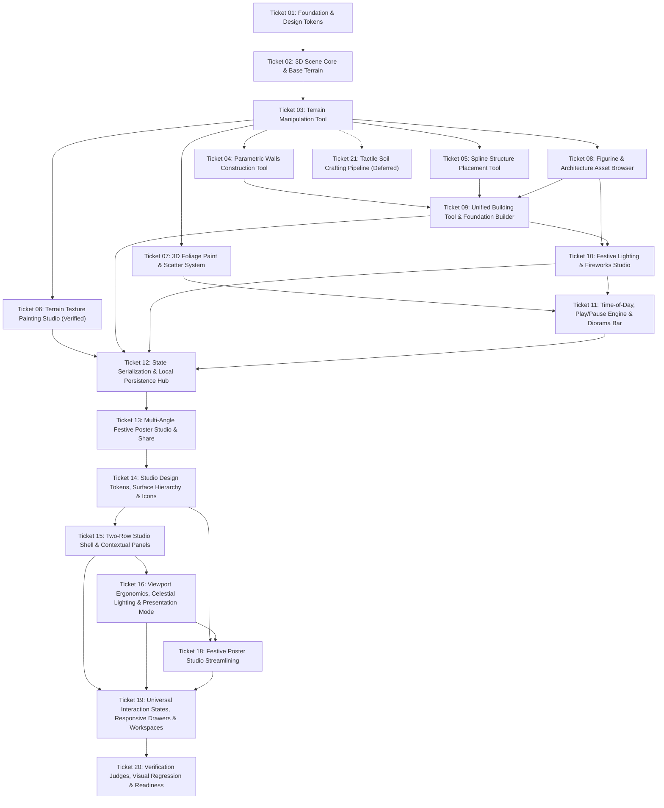

# Killa Playground — Project Roadmap & Tracer Bullet Tickets

This document serves as the master roadmap and tracker for building **Killa Playground**, decomposing the implementation into dependency-ordered tracer-bullet tickets.

The roadmap prioritizes the core Killa construction tools (**Terrain**, **Walls**, **Spline**, **Terrain Paint**, **Foliage Paint**, and **Figurines / Buildings**) so builders can craft and share a complete, historically authentic Diwali Killa immediately, leaving the complex organic soil physics pipeline as a deferred advanced simulation phase.

---

## Dependency Graph

---

## Ticket 01: Project Foundation, Design System Tokens & Responsive Shell

- **Status**: `completed`
- **Blocked by**: None (can start immediately)
- **Delivers**:
  - Initialized Next.js 15 (App Router) + TypeScript + Tailwind CSS application.
  - Complete 3D dependencies (`three`, `@react-three/fiber`, `@react-three/drei`, `three-mesh-bvh`, `three-custom-shader-material`, `fflate`, `zustand`, `zod`, `react-icons/tb`, `lazy-brush`, `canvas-confetti`).
  - Integrated design tokens from `design.md`:
    - Sun-baked canvas (`#F9F6F0`), Dark Brown mineral ink (`#4B382C`).
    - 6-Color Earth Palette: Terracotta (`#B85F45`), Burnt Clay (`#8F4938`), Sand (`#D8C09D`), Camel (`#B58B63`), Olive (`#777A57`), Basalt Charcoal (`#23211E`).
    - Festive Accents: Bhagwa Saffron (`#E85D04`), Chuna White (`#FAF8F5`), Sprouted Halim Green (`#65A30D`), Crinkled Sea Blue (`#0284C7`), Diya Amber (`#F59E0B`).
  - Google Fonts preloaded in `<head>`: `Yatra One`, `Modak`, and `Inter`.
  - Full-bleed responsive diorama canvas shell with non-blocking floating HUD mounts.
  - **Decoupled 5-Zone HUD Layout Architecture**:
    - **Zone 1: Primary App Menu Bar (`AppMenuBar.tsx`)**: Global brand, fort blueprint selector, menus (`File`, `Edit`, `View`, `Language`, `Help`), `EN`|`म`|`हि` language switch, 15-slot undo/redo, night diya mode toggle, and auto-dismissing toast notifications with manual close (`✕`). Pinned top-0 (41px).
    - **Zone 2: Secondary Top Tool Bar (`TopToolBar.tsx`)**: 10 construction/soil tools + camera presets (Z, Y, X, Center, Zoom). Fully minimizable with dynamic hanging tab `[⛰️ Tools & Views ▾]`.
    - **Zone 3: Left Tool Properties Sidebar (`LeftToolSidebar.tsx`)**: Hosts universal/unplaced parameters and initial drafting settings. Resizable from 250px to 480px with tactile 6-dot grip handle. Minimizable with hanging tab `[⚙️ Properties ▾]`.
    - **Zone 4: Vertical Tool Mode Strip (`ToolModeSidebar.tsx`)**: Dedicated 68px vertical strip docked to left sidebar edge. Vertical icon + label buttons for tool-specific operations. Minimizable with hanging tab `[🎯 Modes ▾]`.
    - **Zone 5: Right Scene Outliner & Contextual Inspector (`RightToolSidebar.tsx`)**: Resizable 260px to 460px with tactile grip. Dual-pane: upper `DIORAMA ELEMENTS` tree with expand/collapse, element counts, focus, delete, and hover highlight; lower `ELEMENT PROPERTIES` inspector for selected objects. Minimizable with hanging tab `[🏰 Outliner ▾]`.
  - **Anti-Collision Minimized Guide Tab Positioning**:
    - Coordinated dynamic left and right offsets ensuring all permutations of open and minimized panels never overlap or clip headers.

### Acceptance Criteria
- [x] Application compiles and runs with `npm run dev` at `http://localhost:3000`.
- [x] Canvas viewport expands to 100vw × 100vh with `#F9F6F0` foundation.
- [x] Fonts `Yatra One`, `Modak`, and `Inter` load cleanly with zero FOUT.
- [x] Tailwind tokens configured and verified with test elements.
- [x] Responsive layout adapts cleanly across mobile, tablet, and wide desktop with zero visual overlaps or clipped toolbars.
- [x] Camera controls relocated to secondary toolbar, leaving left sidebar 100% for tool properties.
- [x] Minimized guide tabs line up side-by-side with zero overlap across all open/minimized combinations.

---

## Ticket 02: 3D Scene Core, Camera Rig, Courtyard Bricks & Base Terrain

- **Status**: `completed`
- **Blocked by**: `Ticket 01`
- **Delivers**:
  - Three.js `<Canvas frameloop="demand">` with `<OrbitControls>` (bounded polar angles, smooth damping).
  - Courtyard lighting: warm directional sunlight + ambient bounce + night mode moonlight rig.
  - Base Retaining Brick Border: 3D ring of red clay masonry bricks encircling the mud diorama base.
  - Base Terrain: `THREE.PlaneGeometry(10, 10, 255, 255)` (`65,536` vertices) with `<Bvh>` acceleration (< 0.2ms raycasting).
  - Synchronized `stateBuffer` (`Float32Array` of size `256 x 256 x 4` in `THREE.DataTexture`) storing Elevation (R), Wetness (G), Lock (B), and Grass Density (A).
  - PBR texture loading pipeline connecting Binbun retro textures and mossy stone brick textures.

### Acceptance Criteria
- [x] Diorama canvas displays ground plane with courtyard lighting and brick perimeter border.
- [x] OrbitControls allow smooth 360° orbiting and zooming without clipping beneath the floor.
- [x] Raycaster intersection against terrain mesh executes in `< 0.2ms` via BVH.
- [x] `stateBuffer` initialized and bound to terrain shader pipeline.

---

## Ticket 03: Base Terrain Manipulation Tool

- **Status**: `completed`
- **Blocked by**: `Ticket 02`
- **Delivers**:
  - **Direct Terrain Mesh Sculpting**:
    - **Peak**: Raises mountain mounds, ridges, and hillocks with smooth radial falloff.
    - **Gorge / Trench**: Digs terrain down to carve moat channels, ravines, and valleys.
    - **Plateau / Level**: Flattens sampled vertices to a target plane height $H_{target}$, creating flat courtyards and fort hilltops.
    - **Smooth**: Multi-tap adaptive kernel blur that effectively softens sharp terraces and jagged spikes into rolling earthen curves.
    - **Ramp**: Calibrated inclination subtool with angle presets (15°, 30°, 45°, 60°) for grading smooth paths and fort ascents.
    - **Pond Excavation (Shader-Integrated)**: Excavates crater basins directly in the terrain heightmap and renders authentic blue tarpaulin PBR water with specular ripples directly on the flat basin floor (`wetness > 0.68`), surrounded by dark glistening wet mud (*chikhal*) on crater banks up to the depression rim edge. Eliminates separate meshes, prevents cliff leaks, and restores 100% cleanly on undo.
    - **Retexture**: Restores natural unexcavated soil and basalt surfaces.
  - **Ergonomic Wheel Shortcuts**:
    - `Shift + Scroll Wheel`: Increase / decrease brush size.
    - `Ctrl + Scroll Wheel`: Adjust sculpt speed / strength slider.
    - `Alt + Scroll Wheel`: Adjust plateau height / slope angle.
    - Intercepted in capture phase with complete suppression of camera zoom.

### Acceptance Criteria
- [x] Elevating terrain smoothly raises organic hills and hilltops.
- [x] Lowering terrain excavates depressions that reveal the underlying water plane.
- [x] Plateau tool flattens elevated peaks into level fort construction decks.
- [x] Smoothing tool removes jagged vertices without resetting height.
- [x] Slope tool creates clean graded ramps at 15°, 30°, 45°, 60° presets.
- [x] Excavating ponds renders shader-integrated blue tarpaulin water on basin floors and dark wet mud along banks with full undo/redo support.
- [x] Vertex modifications execute in dirty bounding box ranges without full geometry reallocations.

---

## Ticket 04: Parametric Fort Walls Construction Tool

- **Status**: `completed`
- **Blocked by**: `Ticket 03`
- **Delivers**:
  - **Decoupled 3-Mode Interaction**:
    - **Select Mode**: Inspects walls, corner bastions, watchtowers, rampart platforms, and gates in the Right Scene Outliner and Contextual Inspector. Displays 3D hover highlights (`#E85D04`) and changes cursor to pointer. Selection retention preserves IDs when switching between inspect and edit modes.
    - **Draw Mode**: Click on terrain to draft rampart curves. Start closing node rendered in green, intermediate points in yellow. Features direct "Finish Wall" or "Cancel Draft" actions.
    - **Fortify Mode**: Allows continuous placement of the 3 authentic fortification types via magnetic snap holograms:
      - **Watchtowers**: Sliding continuous round towers snapping to any point along wall segments.
      - **Rampart Bastions**: Inward rectangular stone platforms attached flush to the wall, featuring 3D perimeter protective railings while keeping the outer wall crenellations uninterrupted.
      - **Arched Gateways (*Maha Darwaza*)**: Arched entrances with flanking towers and continuous upper rampart walkways.
  - **Multi-Material PBR Texturing**:
    - Procedural `BufferGeometry` segmented into 3 distinct material groups (`geo.addGroup(start, count, materialIndex)`):
      - **Group 0 (Wall & Tower Sides)**: `mossy_stone_brick_128x128_pbr` (basecolor, normal, roughness, AO).
      - **Group 1 (Walkways & Tower Floors)**: `dark_stone_floor_128x128_pbr` dressed basalt floor slabs for rampart walkways, circular tower/bastion floor decks, and gate lintels.
      - **Group 2 (Battlements & Stone Trims)**: `dark_stone_texture_128x128_pbr` solid dark stone for crenellations (*kangare*), gate soffits, lintel trims, and plinths.
    - Stable material lifecycle in `useMemo([], [])` with `THREE.NearestFilter` and repeat wrapping for authentic retro pixel aesthetic.
  - **Flat 3D Selection Surfaces**:
    - Clickable top floor discs on towers and bastions, portal arch volume meshes on gates, and `BoxPlatformSelectionMesh` on rampart bastions, eliminating floating pin spheres.
  - **Pointer & OrbitControls Isolation**:
    - Strict `e.button === 0` guards on all 3D click handlers ensure right-click and middle-click drag are exclusively reserved for camera navigation without selecting or stamping components.
  - **Miniature Diorama Metric Calibration**:
    - Calibrated default wall height around 25cm (`0.25m`) and thickness to 15cm (`0.15m`) with 12mm ground foundation embedding. Readouts dynamically formatted in centimeters (`cm`).
  - **Authentic Murud-Janjira Pointed Crenellations**:
    - Shaped pointed stone battlements directly matching coastal and Deccan Maratha rampart profiles.
    - Outer-facing orientation automatically detected using 2D polygon centroid testing for closed fort circuits and downhill terrain slope gradient sampling for open wall runs, with manual flip override.
  - **Watertight Maha Darwaza Arched Gateway**:
    - Procedurally carved arched entrance with solid jambs, extruded arch soffit, and continuous top walkway flush with the fort rampart path. Flanked by twin stone bastions.
  - **Real-Time Magnetic Snap Holograms**:
    - Real-time raycast snapping with inward and outward normal calculations (Gate ghost aligned with outward normal, Rampart Bastion ghost aligned with inward courtyard normal).
  - **Defensive Settings Resolution**:
    - Safe fallbacks (`wall.settings || DEFAULT_WALL_SETTINGS`) preventing runtime exceptions on uninitialized objects.

### Acceptance Criteria
- [x] User can click to draft walls that follow terrain contours with "Finish Wall" CTA.
- [x] Wall height and thickness update interactively via sliders in physical centimeters (10cm - 100cm, default 25cm).
- [x] Watchtowers snap continuously along wall segments via magnetic holograms with continuous placement enabled.
- [x] Rampart Bastions attach to walls with protective 3D perimeter railings while preserving outer wall crenellations.
- [x] Fort gates (*Maha Darwaza*) insert cleanly along wall segments with continuous top walkway.
- [x] Multi-material PBR texturing applies stone brick, dark stone floor, and solid basalt stone across geometry groups.
- [x] Right-click drag orbits camera without selecting or stamping components.
- [x] Selection persists cleanly when switching from Select to Fortify mode with pre-activated stamp.

---

## Ticket 05: Spline Structure Placement Tool

- **Status**: `completed`
- **Blocked by**: `Ticket 03`
- **Delivers**:
  - **Decoupled 3-Mode Interaction**:
    - **Select Mode**: Direct physical mesh raycasting on stone steps, saffron flags, and diyas without terrain proximity hijacking. Displays glowing hover outlines (`#E85D04`).
    - **Draw Mode**: Drafts path curves across terrain slopes and atop fort structures using centripetal `THREE.CatmullRomCurve3` (and `LineCurve3` for 2-point segments). Raycast occlusion guard on terrain prevents accidental duplicate points underneath.
    - **Transform Mode**: Translates selected paths in camera-relative directions (Forward, Backward, Left, Right, Up, Down), rotates curves, or adjusts individual item scale without losing active selection.
  - **3 Core Linear Structure Conversions**:
    - **Stone Steps**: Generates stepped horizontal stone boxes ascending slopes. Features 7x larger authentic stone masonry texture scale (`uvMultiplier: 5.0`), lateral offset slider (`stepOffset`: -15cm to +15cm), and stair spacing slider (`stepSpacing`: 1cm to 10cm).
    - **Bhagwa Saffron Flags**: Plants fluttering swallowtail saffron flags at uniform intervals along paths, ridges, or wall ramparts (normalized base scale 1.0x).
    - **Festive Diyas**: Places glowing terracotta oil lamps along path curves for evening illumination (normalized base scale 1.0x).
  - **Clean English UI Voice**:
    - Removed parenthetical Marathi words from UI labels; all language switching handled cleanly through `useTranslation()` (`translations.ts`).

### Acceptance Criteria
- [x] Spline curve drawing cleanly samples 3D surface points across terrain slopes and fort walls.
- [x] Occlusion trapping prevents spline points from leaking through walls to the ground underneath.
- [x] Converting to Stone Steps produces walkable stepped terracing conforming to slope gradient with offset and spacing sliders.
- [x] Converting to Flags places spaced saffron flags with waving swallowtail geometry and pole mast.
- [x] Converting to Diyas arranges warm glowing terracotta oil lamps with flame teardrops along drawn curves.
- [x] Direct physical mesh picking isolates nearby splines without ground proximity hijacking.
- [x] Camera-relative transform controls smoothly translate, rotate, and scale placed spline features.

---

## Ticket 06: Terrain Texture Painting Studio

- **Status**: `completed` (Verified in Browser & Unit Tests)
- **Blocked by**: `Ticket 03`
- **Delivers**:
  - **Direct Terrain Texture Painting**:
    - Paints retro pixel-art textures directly onto the diorama terrain surface without deforming vertex heights or affecting placed walls, splines, or figurines.
  - **Complete 52-Texture Library Across 8 Categories**:
    - **Dirt & Soil (8)**: Compacted Mud, Hydrated Wet Mud, Red Laterite, Clay Silt, Loam Soil, Dry Dirt, Fine Earth, Crumbled Mud.
    - **Grass & Foliage (8)**: Sprouted Mustard Grass, Lush Lawn, Dry Meadow, Olive Turf, Mossy Ground, High Grass, Sprouting Seeds, Dense Field.
    - **Gravel & Paths (8)**: Trail Gravel, Fine Grit, Course Pebbles, Mountain Path, Crushed Stone, River Shingle, Worn Trail, Cobbled Dirt.
    - **Rock & Basalt (8)**: Deccan Basalt, Rugged Slate, Quarry Stone, Weathered Basalt, Sharp Crag, Volcanic Slab, Dark Ledge, Rough Boulder.
    - **Rocky Ground (8)**: Scree Field, Rocky Dirt, Mountain Slag, Pebble Soil, Shaly Terrain, Stony Mud, Chipped Rock, Grit Soil.
    - **Sand (8)**: Sun-Baked Sand, Courtyard Silt, River Dune, Fine Sand, Coarse Dune, Muddy Sand, Beach Soil, Dry Silt.
    - **Bricks & Masonry (3)**: Mossy Stone Brick, Dark Stone Floor, Dark Carved Stone.
    - **Water & Ice (1)**: Blue Tarpaulin Water Sheet.
  - **Technical Architecture & Data Pipeline (`terrainPaintBuffer.ts` & `TerrainMaterial.ts`)**:
    - High-density 256×256×4 `Uint8Array` buffer (262,144 bytes) bound to `THREE.DataTexture`.
    - Channels: R: Layer A (0–51), G: Layer B (0–51), B: Blend Factor (0–255), A: Paint Weight (0–255).
    - `THREE.NearestFilter` on minFilter/magFilter + GLSL `texelFetch` on discrete integer grid coordinates: completely eliminates cross-layer interpolation and seam contour rings.
    - Manual bilinear interpolation in GLSL on continuous float channels (`paintWeight` and same-layer `blendFactor`) for soft feathered edges.
    - Canonical layer ordering (`layerA <= layerB`) across paint and blend brush algorithms for stable gradient transitions.
    - All 52 textures loaded into a single `THREE.DataArrayTexture` (128x128x52) in `THREE.SRGBColorSpace`.
  - **UI/UX & Ergonomics**:
    - Tool renamed to **`Texture`** (key `4`), reserving `paint` for the future soil structure color pipeline.
    - Sliders (Brush Radius, Strength, Edge Falloff, Tiling Repeat) sit directly on the panel background (`bg-[#F3EBE0]`) without enclosing card boxes.
    - Mode selector lives exclusively in the floating `ToolModeSidebar.tsx` strip.
    - Mode-scoped controls: `Paint` (radius, strength, falloff, tiling, flood, clear), `Erase` (radius, strength, clear).
    - Shortcuts: `Shift + Wheel` (Radius), `Ctrl + Wheel` (Strength), `Alt + Wheel` (Falloff), `[` / `]` (Radius step).
    - Dedicated right-side Texture Asset Browser with category pills, dividers, search, and layer index indicators.

### Acceptance Criteria
- [x] User can select any of the 52 textures across 8 categories and paint directly onto terrain.
- [x] Painting produces zero height deformation and does not bleed onto walls, splines, or props.
- [x] Seam border lines (brown, white, gray contour bands) completely eliminated via discrete layer sampling.
- [x] Erase tool smoothly restores unpainted natural base terrain.
- [x] UI respects design guidelines: plain text sliders, mode-specific controls, "Strength" naming, and no parenthetical transliterations.
- [x] 100% client-side compute (₹0 cost) with zero WebGL texture allocation leaks.

---

## Ticket 07: 3D Foliage Paint & Nature Scatter System

- **Status**: `completed`
- **Blocked by**: `Ticket 03`
- **Delivers**:
  - **Retro Doom/PS1 Cross-Quad & Single-Plane Billboard Engine**:
    - High-performance hybrid geometry: 2 intersecting vertical planes (8 vertices, 4 triangles, 12 indices) for volumetric trees/bushes, and single-plane quads for sprawling ground cover, all anchored at ground base $y = 0$.
    - Soft spherical outward normals for uniform, 3D-volumetric lighting on 2D cutout quads.
    - Double-sided rendering with `alphaTest: 0.5` and `depthWrite: true` for zero Three.js sorting artifacts and crisp pixel-art silhouettes.
    - Custom depth material with `alphaTest: 0.5` casting accurate shadow maps onto terrain and walls.
    - Real-time GPU vertex wind sway via material `onBeforeCompile` vertex shader injection with high-frequency fluttering for saplings and low-frequency sway for large canopy trees.
  - **117 Authentic Pixel-Art Foliage Species (7 Categories)**:
    - 117 curated and sanitized 128x128 pixel-art cutout PNG sprites indexed across 7 authentic categories (grass sprites removed from 3D billboard placement to prevent polygon waste; ground turf is authentically handled with zero polygon overhead via Tool 4 Texture Painting):
      - **Canopy Broadleaf (50)**: Banyan, peepal, mango, neem, tamarind, teak, and deodar trees.
      - **Shrubs & Bushes (11)**: Bougainvillea, berry scrub, courtyard hedges, flowering lantana.
      - **Flowering Plants (10)**: Marigold (*gendaphool*), hibiscus, jasmine, periwinkle.
      - **Dry Cliff & Succulents (16)**: Mountain agave, prickly pear, rock crevices, dry thorny brush.
      - **Acacia Savannah (15)**: Spiny acacia, umbrella thorn trees.
      - **Columnar Cypress & Conifers (11)**: Slender Italian cypress, fort sentry conifers.
      - **Coastal Palms (4)**: Coconut palms (curved, slender, tall), date palms, palmyra fan palms.
  - **High-Performance Batched Instancing, Multi-Select Scatter & Spatial Eraser**:
    - Batched rendering via `THREE.InstancedMesh` (exactly 1 draw call per active species) scaling smoothly to 5,000+ instances at 60+ FPS.
    - Uniform disk polar candidate generation with Poisson-disk minimum distance thinning preventing clutter.
    - Bilinear terrain height sampling and surface normal orientation (`getTerrainHeightAt`, `getTerrainNormalAt`), plus direct raycast scattering on fort walls and spline ramparts.
    - **Single Select & Multi-Select Scatter Modes**: Toggle between scattering a single chosen species or randomly picking from multiple selected species with a "Deselect All" convenience button.
    - $O(1)$ spatial hash grid (`FoliageSpatialGrid`) for sub-millisecond radius queries during brush erasing and candidate thinning.
  - **Tri-Mode Workflow & UI/UX Consistency**:
    - **Scatter Mode**: Continuous brush drag painting nature flora across mountain terrain and structures.
    - **Single Mode**: Click-to-place hero specimens with single-point placement reticle.
    - **Erase Mode**: Prune/erase foliage in a radius without affecting underlying terrain or walls.
    - Sliders sit directly on panel background (`bg-[#F3EBE0]`) without enclosing cards: Brush Radius, Density, Scale Jitter, Normal Align.
    - Mode selector lives exclusively in `ToolModeSidebar.tsx`.
    - Dedicated right-side Foliage Asset Browser with search, category pills, counts, and 128x128 pixel-art preview cards.
    - **Permanent Left-Click Action & Right-Click Orbit Control Scheme**: Left click dedicated permanently to active tool operations (`mouseButtons.LEFT = -1`), camera orbit on right-drag, pan on middle-drag, with dynamic bottom contextual info strip and updated keyboard shortcuts modal across EN/MR/HI.
    - Full undo/redo integration with `terrainStore` snapshot history and JSON serialization.

### Acceptance Criteria
- [x] Foliage scatter brush places trees, rocks, and shrubs across terrain, walls, and ramparts.
- [x] Scatter radius and density sliders control brush distribution with single and multi-select support.
- [x] Objects automatically orient to terrain/surface normal or upright Y-axis.
- [x] Rendering 1,000+ scattered instances maintains 60 FPS in single batched draw calls.

---

## Ticket 08: Figurine & Architecture Asset Browser

- **Status**: `completed` (Verified in Browser & Unit Tests)
- **Blocked by**: `Ticket 03`
- **Delivers**:
  - **40 Solid 3D Models Across 7 Authentic Categories**:
    - Sliding right-side drawer with visual preview cards, category filters, counts, and search:
      1. *Royalty & Sinhasan (4)*: Chhatrapati Shivaji Maharaj on the royal throne (*Sinhasan*), cavalry commander, royal attendant, and war elephant.
      2. *Mavale Garrison (4)*: Maratha swordsman, fort sentry spearman, bhagwa flag bearer, and cliff defender.
      3. *Festive Musicians (2)*: Tutari fanfare horn blower, Dhol-Tasha drummer.
      4. *Terracotta Clay Diyas (9)*: 9 unique standalone clay lamp designs (`diya_clay_01` to `diya_clay_09`).
      5. *Hand-Painted Diyas (9)*: 9 vibrant painted color schemes (`diya_color_01` to `diya_color_09`).
      6. *Yard & Props (2)*: Deccan bullock cart and fluttering saffron fort banner.
      7. *Fort Architecture (7)*: Arms depot, elephant stables, fort granary, cavalry stables (with calibrated scale matching fort buildings), fort dungeon/jail, royal kitchen, and soldier quarters.
      8. *Artillery & Ordnance (3)*: Bastion cannon, cannonball crate, and gunpowder magazine.
  - **High-Performance Instanced Batching & Scale Calibration**:
    - Batched rendering via `THREE.InstancedMesh` grouped by figurine type (1 draw call per distinct active type) effortlessly handling 250+ solid 3D figurines at 60+ FPS.
    - Singleton geometry and material cache (`figurineAssetManager`) with automatic base grounding (`y = 0`) and normalized baseline bounding-box scales for humans (0.9m), buildings (3.0m - 4.2m), and artillery (1.2m).
  - **4-Mode Workflow & Right Panel Dual Architecture**:
    - **Place Mode**: Displays Placed Figurines summary and lower Figurine Vault asset browser with live ghost reticle snapping to terrain/wall surfaces, placement scale slider, rotation heading slider, randomize yaw toggle, surface normal alignment, and elevation offset.
    - **Select Mode**: Displays Placed Figurines outliner alongside dedicated Element Properties inspector (scale slider, heading rotation slider, duplicate, snap surface, focus camera, delete) styled consistently with Walls and Spline tools.
    - **Transform Mode**: Displays Placed Figurines outliner and Element Properties inspector with camera-relative 3D nudge pad (Up/Forward/Down/Left/Backward/Right), heading rotation wheel and quick angles, uniform scale slider, and surface snapping.
    - **Erase Mode**: Brush-based radius erasing with `Brush Radius` slider in Left Sidebar, crimson diorama brush ring GUI on terrain/structures, stroke drag erasing, and outliner single/batch deletion.
  - **Ergonomics & Hover Refinements**:
    - Two-way hover highlighting active during Select and Transform modes: hovering a figurine in diorama renders an amber glow ring (`HoverRing`) and highlights the outliner row; hovering an outliner row highlights the 3D figurine in viewport.
    - Hover highlights and pointer cursor changes disabled during Place and Erase modes to eliminate visual clutter and tool confusion.
  - **Processed Transparent Thumbnails & Clean English UI**:
    - Transparent-background WebP/PNG thumbnails for all 40 models (3x3 diya grid cleanly separated into individual icons; corner text and white backgrounds removed).
    - Clean English UI labels with zero redundant parenthetical Marathi transliterations.
  - **Undo / Redo & Secondary Toolbar Header Fixes**:
    - Fixed undo/redo state restoration for both Figurines and Spline tools in `terrainStore.ts`.
    - Fixed `collapseAllPanels` in `useEditorStore.ts` so the secondary toolbar hanging guide tab (`[⛰️ Tools & Views ▾]`) remains visible and clickable alongside `[⚙️ Properties ▾]`, `[🎯 Modes ▾]`, and `[🏰 Outliner ▾]`.

### Acceptance Criteria
- [x] Asset drawer opens smoothly with tabs for Royalty, Mavale, Musicians, Diyas, Props, Architecture, and Artillery.
- [x] All 40 solid 3D models load cleanly with correct relative scale and ground alignment.
- [x] Pre-built buildings, artillery, and figurines can be placed directly onto terrain or fort decks.
- [x] Figurines and props can be dragged, dropped, rotated, transformed, and erased cleanly.
- [x] Placed items persist their transform coordinates in the editor store with working undo/redo.
- [x] "Minimize All" cleanly retains all four hanging guide tabs for quick restoration.

---

## Ticket 09: Unified Building Construction Tool & Foundation Builder

- **Status**: completed
- **Blocked by**: `Ticket 04`, `Ticket 05`, `Ticket 08`
- **Delivers**:
  - **Tool Consolidation & Spline Retirement**:
    - Renames Walls tool to **`Building`** (Key `2`) in the primary toolbar.
    - Completely removes the standalone Spline tool (`spline`, Key `3`). Deprecates redundant flag and diya splines (which now exist as high-fidelity solid 3D models in the Figurine and Lighting tool catalogs).
    - Preserves and integrates stepped stone stairs into the Building tool as **`Stairs` Mode**.
  - **5 Unified Operational Modes in `ToolModeSidebar.tsx`**:
    1. **`Select`**: Direct physical raycast picking of fort walls, bastions, towers, gates, foundations, and stone stairs. Displays glowing amber hover outline (`#E85D04`) and contextually populates the Right Scene Outliner and Element Properties Inspector. Foundation slabs are strictly interactive in Select mode.
    2. **`Walls`**: Click on terrain to draft perimeter wall curves with automatic pointed Murud-Janjira crenellations, continuous elevation tracing, Close Loop (`TbRefresh`), and Finish/Cancel drafting CTAs.
    3. **`Foundation`**: 2-phase drag-and-extrude rectangular stone foundation slabs directly on the terrain:
       - Phase 1 (Base footprint): Pointer down anchors $(x_1, z_1)$; dragging renders live translucent rectangular ghost box to $(x_2, z_2)$.
       - Phase 2 (Height extrusion): Pointer up locks base footprint and switches to vertical height extrusion. Mouse movement dynamically adjusts slab thickness with normalized sensitivity (`0.008`). Left-click confirms and builds the solid slab.
       - Negative Depth: Supports negative heights down to `-10.0m` (extending below terrain surface) up to `+25.0m`.
       - Cancel CTA: Inline Cancel Draft button (`TbX`) in the Left Properties Panel to cleanly abort in-progress drafts.
       - Multi-material buffer geometry partitioning: Perimeter sides mapped to `mossy_stone_brick_128x128_pbr` (Group 0) and top horizontal deck mapped to `dark_stone_floor_128x128_pbr` (Group 1).
    4. **`Stairs`**: Continuous drag-drawing or multi-point slope click path utilizing centripetal `THREE.CatmullRomCurve3` that extrudes stepped horizontal stone masonry boxes conforming to slope gradients, with lateral offset slider (`stepOffset`: -15cm to +15cm), 2x default scale multiplier, and stair spacing slider.
    5. **`Fortifications`**: Continuous magnetic snap hologram placement along walls for 4 authentic fortification types:
       - Watchtowers (`tower` / `buruj`): Sliding cylindrical towers along ramparts.
       - Rampart Platform Bastions (`box`): Inward-facing rectangular fighting platforms.
       - Semicircular Round Bastions (`round_bastion`): Outward-protruding semicircular bastions centered flush on outer wall edge, crowned with 3D pointed Murud-Janjira Kangare battlements with shoulders.
       - Arched Gateways (`gate` / `Maha Darwaza`): Watertight portals with continuous top rampart walkways.
  - **Performance Optimization & Zero GPU/CPU Lag**:
    - Decoupled `wallSnapPreview`, `activeFoundationDraft`, and `hoveredElement` subscriptions from root `FortWalls.tsx` container into dedicated isolated child layers.
    - Memoized `EdgesGeometry` across `SingleWallMesh`, `FoundationMesh`, and `SplineMesh` with cleanup on unmount.
    - Wrapped meshes in `React.memo` with fine-grained state selectors.
    - Explicit `THREE.SRGBColorSpace` and `THREE.LinearMipmapLinearFilter` on diffuse textures, eliminating washed-out bleached white stone appearances.
  - **Unified Outliner & Inspector**:
    - Right Tool Sidebar displays consolidated structures tree under `FORT ARCHITECTURE`: Walls (with nested bastions/towers/gates), Foundations, and Stairs.
    - Element Properties Inspector allows real-time dimension, offset, elevation, and tiling adjustments for selected foundations and stairs.

### Acceptance Criteria
- [x] Top toolbar features "Building" tool; standalone Spline tool is completely removed.
- [x] ToolModeSidebar renders the 5 operational modes: Select, Walls, Foundation, Stairs, Fortifications.
- [x] In Foundation mode, 2-phase drag-to-base and normalized height extrusion functions with negative elevation support and cancel draft CTA.
- [x] Releasing mouse and clicking builds a solid foundation slab textured with stone bricks on sides and dark stone floor on top.
- [x] Foundation height, vertical offset, length, width, and tiling repeat adjust interactively via sliders.
- [x] In Stairs mode, continuous dragging or clicking creates walkable stone staircases with 2x default scale and adjustable spacing.
- [x] Round bastions center flush on outer wall edge with pointed Kangare crenellations matching watchtowers.
- [x] Moving mouse over terrain or structures causes zero frame rate stalls (memoized edges geometry, isolated snap/draft subscriptions).
- [x] Stone brick and basalt textures display authentic dark earthen tones without bleached/white artifacts.
- [x] All building components can be selected, inspected, renamed, and deleted in the Right Outliner.

---

## Ticket 10: Festive Lighting & Fireworks Studio

- **Status**: `completed` (Verified in Browser & Unit Tests)
- **Blocked by**: `Ticket 08`, `Ticket 09`
- **Delivers**:
  - **Dedicated Lighting Tool**:
    - New dedicated **`Lighting`** tool positioned as the **6th and final primary construction tool** (Keys 1-6: Terrain, Building, Texture, Foliage, Figurine, Lighting).
    - Migrates all 18 Diyas (9 terracotta clay + 9 hand-painted) out of the Figurine tool and into the Lighting Studio. Figurine tool is refined strictly to 22 historical royalty, garrisons, architecture, and ordnance models.
  - **Authentic Diwali Pyrotechnics (10 Fireworks Models)**:
    - **5 Cone Fountains (*Anaar*)**: 3D inverted cone models (`ConeGeometry`) with decorative retro Diwali paper wrap canvas textures in 5 vibrant color themes: Saffron Amber, Emerald Green, Royal Violet, Ruby Crimson, and Golden Sparkle.
    - **5 Sky Shots (*Aerial Shells*)**: 3D cylinder launcher models (`CylinderGeometry`) with retro casing textures in 5 festive themes: Multicolored Peony, Golden Willow, Silver Palm, Crackling Comet, and Saffron Ring.
  - **Interactive 3D WebGL Pyrotechnics Engine**:
    - High-performance native Three.js particle engine (`THREE.Points`) using pre-allocated `Float32Array` buffers with zero per-frame garbage collection.
    - Cone Fountains emit a continuous sparkling upward spray with parabolic gravity falloff, crackling embers, and active flickering tip flares.
    - Sky Shots launch an ascending rocket flare tracer with smoke trail that detonates at burst altitude into a dazzling spherical/willow particle burst in the diorama sky.
    - Fully configurable parameters matching pyrotechnic standards: color hue, particle velocity, spray height/spread, burst radius, gravity, and flicker rate.
  - **Consistent 4-Mode Workflow (Place, Select, Transform, Erase)**:
    - `Place`: Left panel renders active preview card + plain text sliders directly on `bg-[#F3EBE0]` (Scale, Heading, Randomize, Normal Align, Elevation Offset); Right panel renders Lighting Vault Asset Browser with search and 3 tabs: Clay Diyas (9), Painted Diyas (9), Fireworks (10).
    - `Select`: Left panel renders selected item summary card + transform sliders + Surface Snap + "Test Firework" button + Duplicate/Delete; Right panel renders Placed Lights Outliner (upper) + Element Properties Inspector (lower) with Burst Height slider for fireworks.
    - `Transform`: Left panel renders fine-grained camera-relative nudge and heading controls; Right panel renders Outliner + Inspector.
    - `Erase`: Left panel renders Brush Radius slider directly on `bg-[#F3EBE0]` + crimson diorama brush circle GUI + Clear All Lights button; Right panel renders Outliner + Inspector.
  - **3D Diya Illumination Engine (Zero Flat Decals & Zero Recompile Freeze)**:
    - Complete elimination of flat 2D decal ground disks (`DiyaLightPools.tsx`), replacing them with authentic 3D PBR illumination that realistically lights up vertical fort walls, ramparts, bastions, figurines, stone steps, and slopes.
    - **16 Statically Pre-Allocated 3D Omnidirectional PointLights** (`#FFA533`, `decay: 2.0`, `distance: 2.2m–4.8m`) compiled statically in JSX. Guarantees **0ms shader recompilation freezes** when placing, moving, or deleting lights.
    - **Camera-Independent 3D World-Coordinate Spatial Clustering** (`computeSpatialClusters`): K-Means clustering in fixed world coordinates guarantees that orbiting the camera 360° causes **zero light popping, zero jumping, and zero white-hot bleaching**.
    - Procedural 3D teardrop flames with organic evening breeze sway, white-hot inner core, and camera-facing volumetric halo sprites (`<sprite>`) with additive blending for luminous visibility from any camera distance.
  - **Diurnal Diya Availability (`getDiyaLightStatus`)**:
    - Diyas automatically ignite during Golden Hour (~16:30 onwards), reach full radiance throughout Diwali Night, and stay lit until morning Dawn (~06:30), or whenever `nightMode` is explicitly enabled.
  - **"Test Firework" Action & Isolated Trigger Pipeline**:
    - Dedicated test trigger pipeline in store (`testFireworkTrigger` with timestamps and cleanup) ensuring fireworks detonate strictly upon clicking the "Test Firework Burst" action button without accidental re-triggers during slider adjustments.
    - Burst height slider for fireworks with a calibrated low default burst (~100cm from launcher).
  - **Zero-Cost State Persistence & Undo/Redo**:
    - Added `PlacedLight` to `SavedProjectSchema` and editor state with undo/redo snapshot buffering, legacy diya migration, burst height serialization, and full reset handling.

### Acceptance Criteria
- [x] Lighting tool appears in Top ToolBar as Key 6; Figurine tool no longer contains diya items.
- [x] Lighting Vault drawer displays 3 tabs: Clay Diyas (9), Painted Diyas (9), and Fireworks (10).
- [x] Placed diyas illuminate in 16 pre-allocated 3D point lights with volumetric halo flames, casting authentic light on vertical fort walls, ramparts, and figurines without flat 2D decal artifacts.
- [x] Camera orbiting 360° produces zero popping or jumping of diya lights.
- [x] Placing and deleting diyas causes zero WebGL shader recompilation freezes (0ms).
- [x] Cone fountains sit upright on terrain/decks and spray sparkling fountain effects on test.
- [x] Sky shots launch upward rockets that explode at adjustable burst heights with colorful particle bursts.
- [x] "Test Firework" button triggers pyrotechnic effects on demand without triggering on property slider edits.
- [x] Placed lights and fireworks can be selected, moved, duplicated, and deleted with full undo/redo.

---

## Ticket 11: Time-of-Day, Play/Pause Animation Engine & Quick-Action Diorama Bar

- **Status**: `completed` (Verified in Browser & Unit Tests)
- **Blocked by**: `Ticket 07`, `Ticket 10`
- **Delivers**:
  - **Dedicated Diorama & Sun View Tool (`view`)**:
    - Primary toolbar **`View`** tool (`view`, Key `7`) designed for pure diorama presentation, inspection, and celestial lighting control.
    - Zero-modification viewport guard: raycasting and drafting disabled during view inspection.
    - Interactive Left Properties Sidebar with:
      - **Time of Day Slider** (`0:00` to `24:00` hours) with dynamic day/night transitions and quick presets: **Dawn (06:00)**, **Noon (12:00)**, **Golden Hour (17:30)**, and **Diwali Night (21:00)**.
      - **Sun / Moon Direction & Elevation (X-Axis Rotation)** slider (`-10°` to `90°` altitude above courtyard horizon) controlling sun/moon trajectory and dynamic shadow length.
      - **Sun / Moon Azimuth** slider (`0°` to `360°` compass bearing) directing shadow orientation across ramparts and courtyards.
      - **Camera Perspectives Presets**: Isometric (45°), Bird's Eye (90° Top-Down), Rampart Eye (15° Low Hero View), Bastion Hero (30° Citadel Corner), and Home Reset.
      - **Camera Lens FOV Slider** (20° Telephoto to 80° Wide-Angle, 45° Standard default).
      - **Dual Navigation Modes**: Free Orbit Spectator Mode (`orbit`) and Continuous 360° Turntable Exhibition Mode (`spin`).
      - **Celebration Fireworks 5s Salvo**: Dedicated test button that triggers all placed fireworks across the diorama for 5 seconds regardless of time, with a 5-second disable cooldown.
  - **Atmospheric Lighting & 24-hr Diurnal Solar Arc Engine (`atmosphericLighting.ts`)**:
    - **Dynamic Color Temperature Grading**: 7 calibrated diurnal keyframes (Midnight 00:00, Dawn 06:00, Noon 12:00, Golden Hour 17:30, Dusk 18:48, Diwali Night 21:00, 24:00).
    - **Luminous Full Moon Night Calibration**: Silver-white moonlight (`#E0F2FE`, 1.35x), indigo shadow fill (`#475569`, 0.85x), dual-radiance hemisphere light (`#93C5FD` sky / `#1E293B` ground, 0.80x), and exposure `1.28`. Eliminates pitch-black voids, rendering terrain, water, cliffs, and fort walls clearly visible.
    - **Vibrant Golden Hour**: Sun 30 minutes before sunset (elevation `20°`, azimuth `255°`, radiant saffron `#F59E0B` 2.80x, courtyard terracotta upward GI bounce `#EA580C` 0.90x, exposure `1.30`).
    - **Zero-Cost Mud GI Bounce Radiance**: Directional light positioned upward from laterite clay simulating secondary bounce illumination.
    - **Deccan Plateau Horizon Mist / Depth Fog**: Exponential squared (`Exp2`) fog blending distant terrain smoothly into the diorama backdrop.
    - **ACESFilmic Tone Mapping & Exposure Calibration**: Prevents specular blowouts on stone and enriches mud and flame saturation.
  - **Centered Quick-Action Diorama Bar (`DioramaQuickBar.tsx`)**:
    - Tactile, floating 5-button control dock mounted centered directly above `BottomStatusBar.tsx`:
      - `☀️ Day`: Transitions diorama to warm daylight courtyard lighting.
      - `▶ Play`: Starts continuous 60 FPS animation loop for trees, particle effects, and continuous night fireworks.
      - `⏸ Pause`: Freezes all wind sway and particle motion; returns canvas to on-demand rendering.
      - `📷 Screenshot`: Hides all HUD chrome, captures the full-resolution WebGL canvas buffer to PNG, triggers direct browser download (`killa-diorama-<timestamp>.png`), and restores the HUD.
      - `🌙 Night`: Transitions to night mode, igniting all placed diyas and firing a celebratory simultaneous fireworks salvo.
  - **Decoupled Animation Engine & Night Fireworks**:
    - Tree vertex wind sway and foliage fluttering are decoupled from mouse movement; animation progression is strictly governed by the `isPlaying` state.
    - Continuous nighttime fireworks playback during dark hours with staggered launches and natural pauses.
    - Cone fountains (*Anaar*) and sky shots feature automatic ±20 cm (±0.20m) height variation and 10° launch angle variation.
    - "Randomize Burst Height" placement toggle switch in Left Tool Sidebar.
    - Deterministic 16-point spatial clustering for diya lights, preventing white-hot bleaching and light-jumping.
  - **Infinite White Grid Removal & Iconography**:
    - Removed `<Grid infiniteGrid />` from the viewport across all tools, giving the diorama an authentic tabletop feel with its courtyard perimeter bricks.
    - All left panel tool headers and controls updated to Tabler React icons (`react-icons/tb`).

### Acceptance Criteria
- [x] Atmospheric lighting engine interpolates 24-hr solar arc with luminous full moon night and vibrant golden hour keyframes.
- [x] Sun/moon direction, elevation, and azimuth sliders sweep dynamic shadows across fort walls and courtyards.
- [x] Diyas automatically ignite during Golden Hour, Dusk, and Night, and remain lit through Dawn.
- [x] Quick-action diorama bar sits centered above the bottom status bar with Day, Play, Pause, Screenshot, and Night buttons.
- [x] Ambient tree fluttering and wind sway progress smoothly when Play is active without requiring mouse moves.
- [x] Clicking Pause immediately halts animation clock and freezes movement.
- [x] Switching to Night mode ignites all diyas and fires all placed fireworks once in celebration.
- [x] Clicking Screenshot captures an unobstructed, high-resolution PNG image directly to browser Downloads.
- [x] Viewport infinite white grid removed across all tools.
- [x] View tool Left Sidebar enriched with camera presets, lens FOV slider, turntable controls, and 5-second fireworks salvo.
- [x] Tool modes provide Orbit Spectator and 360° Turntable Exhibition modes with full raycast drafting suppression.

---

## Ticket 12: State Serialization, Local Persistence Adapter & Project Hub

- **Status**: `completed`
- **Blocked by**: `Ticket 06`, `Ticket 09`, `Ticket 10`, `Ticket 11`
- **Delivers**:
  - **Undo / Redo Buffer**:
    - 15-slot in-memory circular buffer tracking terrain edits, building structures (walls, bastions, foundations, stairs), texture paint, foliage instances, figurines, and placed lights/fireworks.
    - Decoupled `historyVersion` from continuous stroke `lastUpdated` timestamp, preventing React tree re-renders during high-frequency mouse dragging.
  - **Viewport & Tool Performance Optimizations**:
    - **Terrain Tool Modes**: Direct TypedArray vertex manipulation with zero initial drag jitter.
    - **Texture Tool**: Material singleton lifecycle for `CustomShaderMaterial` with in-place uniform updates (`uTexturePaint.value = currentTexture`), eliminating 1-2s initial stroke compilation freezes.
    - **Fortifications & Magnetic Snap**: Camera orbit/pan bypass (`e.buttons !== 0`), sub-centimeter position deduplication guard (`Math.abs(delta) < 0.005`), calibrated 60ms click debounce, and static shared wireframe geometries (`holoRingGeo`, `holoTowerGeo`, `holoBoxGeo`).
    - **Splines & Walls**: Sub-0.2ms BVH raycasting against targeted pickable root containers (`BaseTerrainMesh`, `FortWallsLayer`, `SplineStructuresContainer`, `CourtyardRetainingBricks`) with static shared markers.
    - **Foliage Scatter & Erase**: Distance and time cadence throttling (35ms / 0.05m) during drag, direct remaining array assignment on erase, 512 minimum `InstancedMesh` capacity, `frustumCulled={false}`, and module-level `tempFoliageObject`.
    - **Figurines & Lighting Placement**: Instantaneous shadow reticle synchronization on vault item switch, and instantaneous placement without click queuing.
    - **Auto-Stop Playback on Tool Switch**: Switching primary tools in `useEditorStore.setActiveTool` automatically stops playback (`isPlaying: false`), returning viewport to `<Canvas frameloop="demand">` for maximum UI responsiveness, while switching modes retains playback continuity.
  - **Binary Serialization (`.killa` format v1.2.0)**:
    - Quantize terrain heightmap via 2D spatial prediction into delta-encoded 16-bit integers and perceptual channels (wetness, lock, grass, texture paint weights) into compact `Uint8Array` buffers.
    - Package terrain, building foundations, stairs, walls, fortifications, foliage, figurines, and fireworks with `fflate.zipSync` into a compact `< 35 KB` binary package.
  - **Persistence Adapter & Local Vault**:
    - IndexedDB implementation (`killaVault.ts`) persisting named projects with timestamp (`updatedAt`), template type, diorama statistics, and binary package payload.
    - Two-tab Project Hub Modal (`ProjectHubModal.tsx`) displaying historical fort blueprints, procedural generator, and saved projects with relative time elapsed, one-click loading, and project deletion.
  - **Interactive Terrain Studio Drawer**:
    - Non-blocking top-sliding drawer (`TerrainStudioDrawer.tsx`) allowing real-time inspection of terrain alterations behind controls.
    - Real sliding toggle switch for base water plane (moat / sea).
    - "Roll New Terrain" seed randomizer dice button with instant regeneration.
    - "Stepped Mountain Tiers" slider (1 to 3 tiers) with smooth, tear-free Sahyadri stepped terraces (Balekilla and Machi).
    - Destructive terrain change confirmation popup (`TerrainChangeConfirmModal.tsx`) with itemized object counters protecting placed structures.
  - **Pyrotechnic Pause Timer**:
    - 5-second countdown timer for fireworks in the paused state: keeps particles frozen for 5 seconds for visual admiration, then cleans them up so they do not obstruct building. Normal playback remains unaffected.
  - **Project File Import & Export**:
    - Desktop file download of `.killa` diorama packages and backward-compatible JSON payloads.
    - Native file picker upload to import and restore `.killa` files directly into the 3D canvas with full terrain and texture reproduction.
  - **Defensive Zod Schema**:
    - Validates inbound project payloads, sanitizing coordinates and rejecting malformed files.

### Acceptance Criteria
- [x] Undo and redo reliably revert and restore sculpting, foundations, stairs, walls, painting, and firework placements.
- [x] `serializeKilla()` packages complete killa state into $\le 35\text{ KB}$ in $< 15\text{ms}$.
- [x] Projects save to local storage and appear in the startup hub with last-saved timestamps.
- [x] `.killa` files can be exported and re-imported cleanly with identical visual reproduction.
- [x] Inbound payload schema validates types and rejects corrupted payloads.
- [x] Sculpting, texture painting, and foliage brushing maintain 60 FPS without initial stroke drag hesitation.
- [x] Fortify mode camera orbiting runs at 60 FPS without magnetic snap calculation stalls.
- [x] Primary tool switching automatically returns canvas to demand rendering.

---

## Ticket 13: Showcase, Multi-Angle Festive Poster Studio & Share

- **Status**: `completed`
- **Blocked by**: `Ticket 12`
- **Delivers**:
  - **SVG Multi-Layer Sandwich Compositor (1080 × 1350 px / 4:5 Portrait)**:
    - Layer 1 (Base): High-fidelity vector festival backgrounds (`design_01` to `design_04`) across 4 curated historical themes (*Archway Citadel*, *Maratha Vanguard*, *Sahyadri Sunset*, and *Fortress Bastion*).
    - Layer 2 (3D Views Grid): 1 to 4 images with dynamic grid layouts (4-stacked widescreen horizontal strips matching authentic diorama arch framing, 2×2 quad grid, 3-stacked, 2-stacked, 2-columns, and single full view). **Transparent photo grid gaps** (`border: none`, transparent spacing) allow the background artwork to shine through cleanly without heavy borders or dark box fills.
    - Layer 3 (Overlay 1): Foreground architectural badges, sky fireworks, or mountain elements (`layer_02_...`). Unused cliff backgrounds pruned for crisp framing.
    - Layer 4 (Overlay 2): Foreground figures, artillery cannon, and terrain base (`layer_03_...`), producing a rich 3D layered parallax depth effect.
    - Layer 5 (Typography & Royal Plaque): Authentic Devanagari display typography (`Yatra One`) with strict locale isolation (no Marathi text leakage in English mode). Supports **Royal Stone Plaque** (*Shilalekh* / राजकीय शिलालेख with dark basalt `#26201B` to `#151210` gradient, double gold trim `#D4AF37`, and gold diamond accents `✦`), Traditional Bottom Banner, Corner Stamp, and Pure Artwork.
  - **4 Standard Camera Perspectives & Diurnal Snapshot Pipeline**:
    - **Isometric (45°)**: Complete fort overview, retaining bricks, water moat, and mountain tiers.
    - **Bird's Eye (Top-Down)**: Strategic topographical blueprint layout.
    - **Rampart Eye (15° Low Hero View)**: Dramatic upward entrance view of Maha Darwaza and bastions.
    - **Bastion Hero (30° Citadel Corner)**: Chhatrapati sinhasan, waving flags, and glowing diyas.
    - Live viewport angle support + one-click angle reassignment.
    - **Diurnal Atmospheric Sky & Scene Lighting Overrides**: Automatically composites diurnal sky gradient (Dawn peach-rose, Noon sky blue, Golden Hour fiery amber, Diwali Night deep indigo with twinkling stars) and physical scene lighting overrides matching the chosen time-of-day. Cleanly restores interactive scene lighting post-render.
    - **4-Tile Time-of-Day Selector Per Slot**: Dawn, Noon, Golden Hour, and Night with randomized initial defaults.
    - **Atomic Monotonic Request Versioning**: Monotonically incrementing IDs (`slotRequestVersions[slotIndex] = ++lastRequestId`) discard stale asynchronous renders, eliminating flickering and angle-reverting bugs.
  - **Local Screenshot Gallery Vault (`screenshotVault.ts` & `ConfirmDialog.tsx`)**:
    - Browser IndexedDB storage (`killa_screenshots_db`, store `screenshots`) for diorama snapshots with slot assignment, inline per-slot gallery picker, and single/batch deletion.
    - Viewport screenshot button in `DioramaQuickBar.tsx` captures headless 1920 × 1080 snapshots and dual-saves: direct file download + local IndexedDB gallery.
    - Custom in-app confirmation modal (`ConfirmDialog.tsx`) replaces native browser `window.confirm()` popups.
  - **Foliage Texture Manager Lifecycle Hardening**:
    - Moved texture load callback from `useMemo` into an event-driven `useEffect` subscription with `isMounted` checks and `queueMicrotask` dispatch, eliminating premature state update warnings.
  - **Instant Export & Multi-Channel Social Sharing (`posterShare.ts`)**:
    - Lossless PNG and compact JPG downloads with clean sanitized filenames.
    - Native Web Share API (`navigator.share`) on mobile/desktop for 1-tap sharing to WhatsApp, Instagram Stories, Facebook, Twitter, and AirDrop.
    - One-click image copy to system clipboard (`ClipboardItem`) for WhatsApp Web and Discord.
    - Direct social share links for WhatsApp and X (Twitter).

### Acceptance Criteria
- [x] "Finish Killa" and `File -> Export Festive Poster` open the Poster Studio Modal.
- [x] Poster renders the 5-layer composite sandwich with Layer 2 and Layer 3 overlapping the 3D views.
- [x] Users can select between 1 to 4 images and choose tailored grid layouts with transparent gaps.
- [x] Headless snapshots capture atmospheric sky gradients and physical scene lighting matching slot diurnal time.
- [x] Viewport screenshot button captures headless offscreen snapshots and saves 2 copies (browser download + local gallery).
- [x] Local screenshots can be picked and assigned into poster slots and deleted via custom in-app confirmation popups.
- [x] Presets for titles, greetings, builder names, banner styles, and fonts update live in the canvas preview with strict locale isolation.
- [x] "Download Poster" produces a crisp, high-resolution PNG/JPG file.
- [x] "Share" triggers Web Share API on supported devices, and "Copy Image" copies the PNG to clipboard.

---

## Ticket 14: Studio Design System Tokens, Surface Hierarchy & Iconography

- **Status**: `completed` (`verified`)
- **Blocked by**: `Ticket 13`
- **Delivers**:
  - **Mandatory Pre-Execution Visual Audit & Ticket Refinement Protocol**:
    - *Visual Audit Baseline*: Captured comprehensive baseline suite of 14 screenshots across Desktop (1920×1080), Tablet (1024×768), and Mobile (390×844) viewport breakpoints saved in `screenshots/audit-baseline/` via native Chrome DevTools Protocol (CDP).
    - *Ticket Refinement*: Plan document approved (`ticket_14_studio_design_tokens_plan.md`) incorporating user guidance to preserve `Yatra One` for brand marks, hero headlines, and poster plaques while standardizing `Inter` across all UI controls.
    - *Visual Verification*: Captured comprehensive post-execution suite of 14 verified screenshots saved in `screenshots/audit-verified/` confirming the complete de-beiging overhaul, 3-tier surface hierarchy, unified Lucide iconography, and normalized radii.
  - **3-Tier Surface Hierarchy (De-beiging Overhaul - Review Item 1)**:
    - Eliminated uniform beige wash across panels, docks, and modals.
    - Established 3 clear visual surface tiers in `tokens.ts` and `globals.css`:
      - *Level 1 (Base Viewport Canvas & Floor):* Neutral warm stone foundation (`#F4F1EA`).
      - *Level 2 (Raised Panels & Dock Shells):* Warm grey/stone (`#EBE6DC`) with 1px hairline dividers (`#D8D1C5`).
      - *Level 3 (Dark Active & Selected Surfaces):* Basalt dark stone (`#2B2621`) for high-contrast active items, with crisp off-white labels (`#FAF8F5`).
    - Burnt Terracotta (`#B85F45`) strictly reserved for meaningful actions and active selections.
  - **Typography System & Micro-Copy Standardization (Review Item 2)**:
    - Standardized interface font on `Inter` with tabular numerals (`tabular-nums font-mono text-[11px]`) for all numeric measurements, slider readouts, and coordinates.
    - Strict 5-tier type scale:
      - *Panel Titles:* 13–14px Semi-Bold (`font-semibold`).
      - *Section Headers:* 12px Medium (`font-medium`) in sentence case.
      - *Control Labels:* 11px Regular/Medium (`font-normal` / `font-medium`).
      - *Readout Values:* 11px Tabular Numbers (`tabular-nums font-mono`).
      - *Helper Text:* 10px Muted (`text-[#7C7267]`).
    - Display typeface `Yatra One` reserved strictly for brand mark ("The Killa Playground"), large modal hero titles, and poster title plaques.
  - **Lucide Icon Standardization (Review Item 3)**:
    - Completely replaced all ~94 Tabler icons (`react-icons/tb`) across all 20+ HUD components and modal dialogs with unified **Lucide** icons.
    - Standardized bounding boxes to 16–18px with uniform `strokeWidth={1.75}` (or `1.5` on large hero icons) and color inheritance (`currentColor`).
    - Commercial brand logos (WhatsApp, X) authored as clean 16px inline SVG path components.
    - Verified via automated AST regression test `iconMigration.test.ts` (0 Tabler imports).
  - **Normalized Border Radius & Hairline Divider System (Review Item 4)**:
    - Established strict 4-tier radius system:
      - `8px` (`rounded-lg` / `rounded-md`): Buttons, inputs, sliders, and segmented pills.
      - `12px` (`rounded-xl`): Asset cards, preset tiles, and contextual popovers.
      - `16px` (`rounded-2xl`): Major sidebars, docks, and drawers.
      - `20px` (`rounded-[20px]`): Modal dialog shells.
    - Replaced nested card boxes with clean structural whitespace and subtle 1px hairline dividers (`border-[#D8D1C5]`).
  - **Quieter Interface Restraint (Review Item 5)**:
    - Unified interaction colors around primary accent: Burnt Terracotta (`#B85F45`), hover `#A24F37`.
    - Clear semantic colors reserved strictly for: Success (`#15803D`), Warning (`#D97706`), and Error/Destructive (`#DC2626`).

### Acceptance Criteria
- [x] Live UI visual audit completed and documented with screenshots before code modifications begin (`screenshots/audit-baseline/`).
- [x] Ticket 14 deliverables updated in `roadmap.md` with refined tokens, radii, and verified visual audit evidence.
- [x] 3-tier surface hierarchy applied across all toolbars, sidebars, and modals without flat beige wash.
- [x] Typography scale implemented with `Inter`, sentence case headings, and tabular numerals on all numeric readouts (`Yatra One` for brand/hero display).
- [x] Lucide icons standardized to 16-18px with uniform stroke and color inheritance (`iconMigration.test.ts` passing).
- [x] Border radius normalized to 8px / 12px / 16px / 20px, eliminating nested-card syndrome.
- [x] Accent color unified to burnt terracotta with reserved semantic states.

---

## Ticket 15: Two-Row Studio Header, Compact Tool Rail & Contextual Panels

- **Status**: `completed` (`verified`)
- **Blocked by**: `Ticket 14`
- **Delivers**:
  - **Mandatory Pre-Execution Visual Audit & Baseline Protocol**:
    - *Visual Audit Baseline*: Captured comprehensive 26-image baseline suite in `screenshots/ticket15-baseline/` across all tools, subtools, menus, and responsive viewports.
    - *Ticket Refinement*: Plan document approved (`ticket_15_studio_header_tool_rail_and_contextual_panels.md`) establishing the exact 2 standard Right Panel layout contracts:
      1. *Dual-Pane Layout*: Upper Scene Outliner hierarchical tree (`Scene Outliner`) + Lower Element Inspector (`Element Inspector`) for structural tools (`building`, `walls`, `spline`).
      2. *Single-Pane Layout*: Full-height Asset Browser (`Asset Browser` / `Texture Browser` / `Foliage Browser` / `Figurine Vault` / `Lighting Vault`) with category filter pills and live search for catalog tools (`texture`, `foliage`, `prop`, `lighting`).
    - *Visual Verification*: Captured post-execution suite of 20 high-resolution verified screenshots in `screenshots/ticket15-verified/` proving clean two-row alignment, direct slider mounting, compact tool rail toggling, and contextual panel groupings.
  - **Two-Row Studio Navigation Hierarchy (Review Item 6)**:
    - Standardized fixed header heights: Row 1 = `38px`, Row 2 = `34px` (`STUDIO_HEADER_HEIGHT_EXPANDED = 72`, `STUDIO_HEADER_HEIGHT_COLLAPSED = 38`).
    - *Row 1 (Global Brand & Document Bar)*: Logo shield, project title, document state indicator (glowing terracotta unsaved dot `#B85F45` vs saved green dot `#15803D`), undo/redo with state counters, global action buttons, and dropdown menus (`File`, `Edit`, `View`, `Settings`, `Help`). Secondary settings (Language selector, preferences) cleanly relocated into `Settings` dropdown.
    - *Row 2 (Workspace Tool Bar)*: Compact horizontal tool selector tabs with concise labels, camera axis shortcuts (`Z`, `Y`, `X`, `Focus`, Zoom `+`/`-`), and synchronized hanging toggle pill.
    - Sidebars and hanging tabs dynamically synchronize top offsets between `top-[72px]` (expanded) and `top-[38px]` (minimized).
  - **Compact Vertical Tool Rail (Review Item 8)**:
    - Implemented compact icon-only rail (`w-[48px]`) with toggle to labeled rail (`w-[68px]`).
    - Categorized logical tool groups (*Sculpt / Refine / Paint*, *Select / Build*, *Brush / Erase*) separated by subtle hairline dividers (`border-[#D8D1C5]`).
    - High-contrast active badges (`bg-[#2B2621] text-[#FAF8F5]` with `#B85F45` terracotta indicator) and micro-tooltips with keyboard shortcuts (`1`–`7`, `B`, `E`, `R`, `P`, `L`).
  - **Contextual Left Properties Panel (Review Item 9 & User Refinements)**:
    - Reorganized continuous slider lists across all tools into standardized contextual groupings (`Geometry`, `Placement`, `Appearance`, `Behavior`, `Lighting`, `Camera`).
    - Redesigned advanced properties: eliminated accordion boxes at the end of panels. Instead, a clean checkbox (`[✓] ADVANCED SETTINGS`) is fixed at the bottom of the panel only on tools with changeable advanced properties (`walls`, `paint`, `foliage`, `prop place`, `lighting place`).
    - When ticked ON, extra properties appear directly inside their appropriate sections (`Appearance`, `Placement`, `Behavior`) in the exact same style as standard properties.
    - Terrain tool displays no advanced properties or checkbox (removed read-only info). View tool moves `Test Fireworks Salvo` directly to the top under the header card, with no advanced checkbox.
    - All sliders mount directly on the Level 2 panel background (`bg-[#EBE6DC]`) using `w-full h-1.5 bg-[#D8D1C5] rounded-lg appearance-none cursor-pointer accent-[#B85F45]` and tabular numerals (`tabular-nums font-mono text-[11px]`), with zero enclosing white cards.
  - **Right Panel Shell Alignment & Two Standard Layouts (Review & User Feedback)**:
    - Aligned `RightToolSidebar.tsx` with Level 2 neutral surface hierarchy and synchronized `top-[72px]` / `top-[38px]` offsets.
    - Standardized **Dual-Pane Layout**: Upper *Scene Outliner* (`t.sidebars.right.sceneOutliner`) hierarchical tree with expand/collapse, element counts, focus, delete, and hover highlight; Lower *Element Inspector* (`t.sidebars.right.elementInspector`) with clean empty state (`t.sidebars.right.selectToInspect`). Used for structural tools (`building`, `walls`, `spline`) and edit modes (`prop select/transform/erase`, `lighting select/transform/erase`).
    - Standardized **Single-Pane Layout**: Full-height asset browsers for textures, foliage, figurines (`place` mode), and lights (`place` mode) with filter pills, search, and responsive cards. Figurine outliner is strictly restricted to `select`, `transform`, and `erase` modes.

### Acceptance Criteria
- [x] Pre-execution screenshot audit completed across all 10 tools, left panel states, and right outliner (`screenshots/ticket15-baseline/`).
- [x] Top navigation consolidated into two clean rows: Row 1 global/menus (38px), Row 2 workspace tabs (34px).
- [x] Vertical tool rail features grouped tools, keyboard shortcuts, tooltips, and compact icon-only mode (48px / 68px).
- [x] Left property panels organized into `Geometry`, `Placement`, `Appearance`, and `Behavior` with collapsible advanced accordions.
- [x] Right sidebar aligned to studio shell with standardized dual-pane layout (Outliner + Inspector) and single-pane asset browsers.
- [x] All sliders mount directly on panel background without white container cards.

---

## Ticket 16: Viewport Ergonomics, Celestial Lighting & Presentation Mode

- **Status**: `completed` (Verified in Browser & Vitest Suites)
- **Blocked by**: `Ticket 15`
- **Delivers**:
  - **Mandatory Pre-Execution Visual Audit & Ticket Refinement Protocol**:
    - *Visual Audit Baseline*: Captured 9 screenshots of `DioramaQuickBar.tsx`, bottom status bar, viewport axes, grid overlays, brush reticles, and lighting tool panel across diurnal phases into `screenshots/ticket16-audit/`.
    - *Ticket Refinement*: Detailed implementation plan artifact created (`ticket16_viewport_celestial_presentation_plan.md`) and user-approved.
    - *Visual Verification*: Captured high-res verification screenshots confirming consolidated toolbar, keycaps, wireframe, presentation mode, section reset icons, and celestial studio.
  - **Unified Bottom Viewport Toolbar (Review Item 11)**:
    - Built `ViewportBottomBar.tsx` consolidating bottom viewport controls into two distinct clusters anchored at bottom-center (`bottom-3 md:bottom-5`), eliminating the two competing vertically stacked bars:
      - *Cluster 1 (Camera Presets):* Isometric (45°), Bird's Eye / Top (90°), Rampart Eye (15°), Home (`Focus`).
      - *Cluster 2 (Environment & Viewport Actions):* Day/Night toggle, Play/Pause animation toggle, Turntable 360° spin, Snapshot camera button, and 1-Click Presentation Mode.
    - Added micro-tooltips and trilingual localization (`en`, `mr`, `hi`). Re-exported as `DioramaQuickBar` for backward compatibility.
  - **Subtle & Toggleable Viewport Guides (Review Item 12)**:
    - Reduced Blender red/green world axes opacity by 50% (`0.60` -> `0.30`) for a cleaner diorama focus.
    - Added View menu toggles: `View -> Presentation Mode (P)`, `View -> Show Viewport Guides`, `View -> Show Wireframe`, `View -> Show Brick Retaining Ring`.
    - Integrated dynamic `BaseTerrainWireframe` overlay with warm terracotta lines (`#B85F45`) rendered at `0.35` opacity.
    - Refined 3D brush hover reticle in `BaseTerrain.tsx`: replaced neon orange rings with subtle anti-aliased terracotta rings (`#B85F45`) at `0.55` opacity with proportional scaling.
  - **Dedicated Diorama Presentation Mode (Review Item 13)**:
    - 1-click exhibition presentation mode (Key `P`, View menu, or bottom bar `Present` button):
      - Smoothly collapses menu bar, tool shelf, left properties, vertical mode rail, right outliner, and keycaps.
      - Hides all 3D editing guides, brush reticles, wireframes, coordinate axes, and brick retaining ring (if desired).
      - Renders `PresentationGlassBar.tsx`: minimalist dark stone glass bar (`bg-[#2B2621]/85 backdrop-blur-xl border border-white/20`) with 5 camera view presets, turntable spin, day/night toggle, screenshot button, poster studio shortcut, and exit button (`Esc`).
      - Full keyboard binding: `P` toggles presentation mode, `Esc` cleanly exits presentation mode (after dismissing open modals).
    - **Presentation Mode Interaction Guard**:
      - Automatically switches `activeTool` to `'view'` mode while recording `prePresentationTool`, preventing accidental terrain sculpting, wall drawing, or painting during presentation.
      - Pointer handlers in `BaseTerrain.tsx` return immediately in presentation mode; OrbitControls mouse buttons strictly mapped to `LEFT: THREE.MOUSE.ROTATE`.
      - Exiting presentation mode cleanly restores the user's previous tool and tool mode.
  - **Preset-First Celestial Lighting Studio (Review Item 14)**:
    - Reorganized View & Celestial Studio panel (`activeTool === 'view'`) in `LeftToolSidebar.tsx` with 4 prominent cards:
      - 🌅 *Dawn (06:00)*: Soft rose-gold morning light, long mountain shadows.
      - ☀️ *Noon (12:00)*: Crisp high-angle sun, vibrant earthen textures.
      - 🌇 *Golden Hour (17:30)*: Warm amber sunset, blazing bastion silhouettes.
      - 🌙 *Diwali Night (21:00)*: Deep star-lit indigo sky, glowing diyas, and celebratory fireworks.
    - **Standard Advanced Settings Pattern**: Aligned with all other sidebar tools using a fixed footer checkbox `[✓] ADVANCED SETTINGS` (`showAdvanced`) that reveals granular sliders: Sun Elevation, Sun / Moon Azimuth, Time of Day, Light Bounce, Atmospheric Fog, Camera Exposure, and a 1-click `Reset to Preset Defaults` button.
    - Added quick celestial preview pills (`[Day] [Golden Hour] [Night]`) inside Lighting tool (`place` mode).
  - **Contextual In-Canvas Tool Instructions (Review Item 15)**:
    - Built `ContextualKeycaps.tsx`: floating keycap capsule pinned at `bottom-16` directly above the viewport toolbar:
      - *Sculpting:* `[Drag] Elevate` • `[Ctrl+Drag] Lower` • `[Shift+Scroll] Radius`
      - *Foliage:* `[Drag] Scatter` • `[Alt+Drag] Erase` • `[Shift+Scroll] Radius`
      - *Walls / Spline:* `[Click] Add Node` • `[Enter] Finish Wall` • `[Esc] Cancel`
      - *Figurines / Lights:* `[Click] Place` • `[Shift+Scroll] Scale` • `[Ctrl+Scroll] Rotate`
      - *View Mode:* `[Drag] Orbit` • `[Middle Drag] Pan` • `[Scroll] Zoom`
    - Auto-dismisses during presentation mode, screenshots, or open dialogs; includes dismiss `×` button.
  - **Section Reset Icons on All Properties Dividers**:
    - Added subtle `RotateCcw` reset icon to every contextual divider section across all tools and tool modes (`GEOMETRY`, `APPEARANCE`, `PLACEMENT`, `BEHAVIOR`, `LIGHTING`, `CAMERA`), allowing 1-click resets to section defaults.
  - **Panel Minimize All & Maximize All in Top Bar**:
    - Restored `Minimize All` (`Minimize2`) and `Maximize All` (`Maximize2`) buttons inside the quick actions pill of `AppMenuBar.tsx` right next to Undo, Redo, and Reset.

### Acceptance Criteria
- [x] Pre-execution screenshot audit completed for viewport overlays, quick-action bar, and lighting controls (`screenshots/ticket16-audit/`).
- [x] Single consolidated bottom viewport toolbar replaces multiple floating control pills (`ViewportBottomBar.tsx`).
- [x] Viewport guides feature reduced opacity and are individually toggleable via the View menu (`showGuides`, `showWireframe`, `showBrickRing`).
- [x] Presentation mode hides all sidebars, rails, and guides with 1-click entry (`P`) and `Esc` exit (`PresentationGlassBar.tsx`), with interaction guard switching controls to view mode.
- [x] Lighting panel promotes 4 celestial presets first, housing granular sliders behind the standard `[✓] ADVANCED SETTINGS` checkbox.
- [x] Section reset icons added to all properties dividers across all tools and tool modes.
- [x] Minimize All and Maximize All quick actions restored to top menu bar.
- [x] Contextual keycaps and instructions dynamically reflect active tool state (`ContextualKeycaps.tsx`).
- [x] Vitest unit test suite passes with 100% success (`src/components/hud/ticket16.test.ts` - 19 tests, 38 suites, 273 tests).
- [x] Production build passes with 0 errors (`npm run build` static prerender 7/7).

---

## Ticket 18: Festive Fort Poster Studio Streamlining

- **Status**: `completed`
- **Blocked by**: `Ticket 14`, `Ticket 16`
- **Delivers**:
  - **Mandatory Pre-Execution Visual Audit & Ticket Refinement Protocol**:
    - *Visual Audit Baseline*: Open the Poster Studio modal (`PosterStudioModal.tsx`) and capture screenshots of all 4 photo slot configurations, background theme selection, plaque text inputs, and export dropdowns (`screenshots/ticket18-audit/`).
    - *Ticket Refinement*: Document repetitive slot parameters, scrolling behavior (1,879px height), and live preview latency; update ticket criteria before restructuring the modal layout.
    - *Visual Verification*: Capture screenshots verifying compact slot navigator, live synchronized selection, and pinned action dock.
  - **Compact 4-Slot Navigator (Review Item 17)**:
    - Replace the long, repetitive vertical scrolling list for Slots 1–4 with a clean, horizontal slot navigator strip (`Slot 1` • `Slot 2` • `Slot 3` • `Slot 4`).
    - Clicking a slot activates its settings in a focused slot inspector, displaying its current camera perspective, time of day, and image source.
  - **Synchronized Slot Selection Feedback**:
    - The active slot is visually emphasized in both the 4:5 poster preview canvas (subtle corner bracket highlight `┌ ┐ └ ┘`) and the slot navigator strip.
    - Direct click-to-select on the 4:5 poster preview canvas activates the corresponding slot in the inspector.
  - **Logical Parameter Grouping & Sticky Dock**:
    - Tabbed organization separating *Slots & Layout* from *Poster Style* (themes, royal plaque, branding).
    - Slot parameters organized into clean grouped sections:
      - *Image Source:* Live Viewport vs Local Screenshot Vault thumbnail picker vs 3D Presets.
      - *Camera Perspective:* Isometric (45°), Rampart Eye (15°), Bird's Eye (90°), Bastion Hero (30°).
      - *Diurnal Lighting:* Dawn, Noon, Golden Hour, Diwali Night.
    - Sticky layout: the live 1080×1350 poster preview and export action dock (`Download PNG`, `Download JPG`, `Share`, `Copy Image`, WhatsApp, X) remain permanently pinned and accessible without scrolling.

### Acceptance Criteria
- [x] Pre-execution screenshot audit completed across all poster modal tabs and slot settings (`screenshots/ticket18-audit/`).
- [x] Compact 4-slot navigator replaces repetitive vertical scrolling lists (`PosterStudioModal.tsx`).
- [x] Active slot visually syncs between canvas preview highlight and inspector controls.
- [x] Global styling and per-slot controls cleanly separated into tabs (`Slots & Layout` vs `Poster Style`).
- [x] Live preview and export action dock remain sticky and fully accessible during editing.
- [x] Dedicated Vitest test suite passes (`src/components/hud/ticket18.test.ts` - 9 tests, 39 suites, 282 tests).
- [x] Next.js production build passes with 0 errors (`npm run build` static prerender 7/7).

---

## Ticket 19: Universal Interaction States, Responsive Drawers & Workspaces

- **Status**: `completed` (Verified in Headless Chrome CDP & Vitest Suites)
- **Blocked by**: `Ticket 15`, `Ticket 16`, `Ticket 18`
- **Delivers**:
  - **Mandatory Pre-Execution Visual Audit & Ticket Refinement Protocol**:
    - *Visual Audit Baseline*: Captured 12 baseline screenshots across mobile (390x844), tablet (820x1180), and desktop (1440x900) into `screenshots/ticket19-audit/`. Identified and documented sidebar screen occlusion on mobile (< 1024px), missing keyboard focus rings, and native `window.confirm` dialogs.
    - *Ticket Refinement*: Detailed implementation plan artifact created (`ticket_19_plan.md`) integrating user blueprint for mobile navigation and approved by user.
    - *Visual Verification Suite (13 Screenshots in `screenshots/ticket19-verified/`)*:
      1. `01_mobile_top_nav_joystick_fabs.png`: Mobile top nav (camera cycle, axis cycle, undo, redo, reset, day/night, turntable, screenshot) + virtual double-ring joystick flanked by Left/Right FABs + peek bottom drawer.
      2. `02_mobile_hamburger_menu_open.png`: Mobile slide-over studio menu with File, Workspaces, Guides, Language switcher, and Help options.
      3. `03_mobile_bottom_drawer_properties.png`: Bottom drawer open in half state (50vh) embedding `LeftToolSidebar` directly with mud sliders, and virtual joystick + FABs shifted cleanly upward into the 3D viewport without overlapping.
      4. `04_mobile_bottom_drawer_assets.png`: Bottom drawer open with `[ Assets ]` tab embedding `RightToolSidebar` texture palette cards and search.
      5. `05_mobile_bottom_drawer_outliner.png`: Bottom drawer open with `[ Outliner ]` tab embedding `RightToolSidebar` scene tree hierarchy.
      6. `06_mobile_radial_tool_in_place.png`: Left FAB clicked, replacing virtual joystick in-place with 144px SVG donut radial tool menu.
      7. `07_mobile_radial_mode_in_place.png`: Right FAB clicked, replacing virtual joystick in-place with sub-tool mode radial pie dial.
      8. `08_mobile_presentation_vertical_left.png`: Presentation mode on mobile with vertical floating glass bar pinned to the left edge.
      9. `09_mobile_startup_modal_fit.png`: `ProjectHubModal` fitting 100% on 390px mobile screen without horizontal scrolling.
      10. `10_desktop_standard_workspace.png`: Desktop Standard workspace with Left Properties, Right Architecture Outliner, and bottom bar single Camera Cycle button (`Isometric -> Top -> Rampart -> Home`).
      11. `11_desktop_minimized_handles_uniform.png`: All 4 minimized folder tabs (Properties, Mode, Outliner, Tools & Views) styled uniformly (`h-[26px]`, `bg-[#EBE6DC]`, `border-[#D8D1C5]`) with pinned non-overlapping coordinates.
      12. `12_desktop_focus_workspace.png`: Desktop Focus workspace with Left Properties open and Right panel hidden for focused crafting.
      13. `13_desktop_presentation_workspace.png`: Desktop Presentation exhibition with horizontal floating glass bar including workspace layout cycle button and Esc exit button.
  - **Comprehensive Bug Fixes Across Desktop & Mobile**:
    - *Desktop Right Panels Restored*: Fixed workspace layout restoration logic in `useEditorStore.ts` and `PresentationGlassBar.tsx`, eliminating trapped `'focus'` state that was causing the right panel to permanently disappear.
    - *Minimized Folder Handles*: Pinned non-overlapping fixed coordinates (`left: 8px`, `left: 116px`, `right: 8px`, `right: 150px`) with synchronized top offsets (`top-[38px]` when top bar minimized, `top-[72px]` when open) and uniform styling (`h-[26px]`, `bg-[#EBE6DC]`).
    - *Desktop ViewportBottomBar Camera Cycle*: Consolidated 4 separate camera preset buttons into a single dynamic button that cycles `Isometric -> Top -> Rampart -> Home` with rotate icon indicator.
    - *Workspace Layout Cycling*: Fixed `toggleWorkspaceLayout` and `setPresentationMode` to cycle cleanly `standard -> focus -> presentation -> standard` on both desktop and mobile. Added workspace switcher button to desktop and mobile presentation glass bars.
    - *Mobile Hamburger Menu (☰)*: Restored slide-over studio menu with all top bar sub-options (File, Workspaces, Guides, Language, Help) rather than opening the startup screen.
    - *Startup Modal Mobile Optimization (`ProjectHubModal.tsx`)*: Eliminated horizontal scroll clipping by adding `overflow-x-hidden`, responsive padding (`p-2 sm:p-4`), compact tab strip, and truncated text.
    - *Mobile Top Nav Space Optimization*: Added camera view preset cycle button (`Iso/Top/Rmp/Hom`), snap axis cycle button (`Z/Y/X`), and used saved space to include Undo, Redo, Reset terrain in top row, plus Turntable 360° spin and Screenshot in lower sub-bar.
    - *Mobile Presentation Mode Controls*: Pinned floating glass bar vertically to the left (`left-3 top-1/2 -translate-y-1/2`) on screens < 1024px to prevent horizontal cut-off.
    - *Single-Stage Mobile Bottom Drawer*: Enforced single pull-up (`44px` peek to `50vh` open) with zero multi-stage bouncing. Automatically shifts thumb-corner FABs to `bottom: calc(50vh + 14px)` so they float cleanly above the drawer.
    - *Thumb-Corner Floating Action Buttons & Individual Radial Menus (`VirtualJoystick.tsx`)*: Removed the central 140px virtual joystick from mobile viewports (< 1024px) to eliminate diorama screen occlusion, relying on native viewport multi-touch gestures (1-finger orbit, 2-finger pan, pinch zoom, single-tap tool action, double-tap drag for continuous sculpt/paint). Retained dual thumb-corner Floating Action Buttons:
      - Left FOB (`left-4 sm:left-6`): 44×44px Sub-Tool Mode Selector button with active mode icon; tapping opens an individual SVG Radial Donut Wheel (`wheelSize: 156px`, inner $r=28\text{px}$, outer $r=76\text{px}$) with mode slices.
      - Right FOB (`right-4 sm:right-6`): 44×44px Primary Tool Selector button with active tool icon; tapping opens an individual SVG Radial Donut Wheel (`wheelSize: 156px`) with 7 primary construction tools.
      - Tapping any slice updates the tool/mode, updates the FOB icon, and closes the menu immediately. Includes 1-tap backdrop overlay dismiss.
    - *Direct Desktop Panel Reuse & Section Separation*: Embedded `<LeftToolSidebar isDrawer />` and `<RightToolSidebar isDrawer />` into the mobile bottom drawer as tabbed views (`[ Properties ]`, `[ Assets ]`, `[ Outliner ]`, `[ Element ]`), guaranteeing 100% feature and state parity with zero scratch reimplementations. Separated the upper Outliner section from lower Element Properties; selecting an element in Outliner automatically switches the drawer to the `[ Element ]` tab.
    - *Camera View Perspective Cycling Fix*: Resolved one-shot `cameraViewPreset` nullification bug by introducing persistent `activeCameraPreset` in `useEditorStore.ts`. The cycle button continuously advances through `Isometric (Box) -> Top (Eye) -> Rampart (Castle) -> Home (Focus)` on desktop bottom bar, mobile top bar, and mobile vertical presentation bar with synchronized icon and label updates.
    - *Unified Gesture Controller (`gestureController.ts`)*: Integrated multi-touch and pointer gesture detection separating diorama orbiting (single drag) from tool actions (discrete tap: $<8\text{px}$ travel, $<350\text{ms}$ duration), continuous strokes (double-tap drag), viewport pan (two-finger drag), pinch zoom, volume button property adjustment (primary brush size/intensity), and trackpad shortcuts.
    - *Redundant Workspace Buttons Cleanup*: Removed redundant Standard/Focus view buttons from `AppMenuBar.tsx` and `MobileTopNav.tsx` in favor of a 1-tap `Present` button. Removed the redundant Presentation button from presentation toolbars.
    - *Mobile Poster Studio Optimization & Access*: Added a dedicated `Poster` button to the mobile upper top bar (`MobileTopNav.tsx`) and an `HD Poster` entry to the hamburger menu. Redesigned `PosterStudioModal.tsx` for mobile: upper half (`h-[40vh]`, `aspectRatio: 1080/1350`, `height: 100%`, `maxWidth: 100%`) displays the full 4:5 preview without scrolling; lower half hosts dual desktop-identical tabs (`[ Slots & Layout ]`, `[ Poster Style ]`) and sticky export dock.
  - **Sahyadri Destructive Confirmation Modal Engine (`DestructiveConfirmModal.tsx`)**:
    - Replaced all native browser `window.confirm` calls in `LeftToolSidebar.tsx` with an accessible, themed dialog featuring backdrop blur, autofocus, keyboard trap (`Escape` to dismiss, `Enter` to confirm), and terracotta destructive button styling.
  - **Trilingual Localization (`translations.ts`)**:
    - Full English, Marathi, and Hindi translations for all workspace layouts, mobile drawer tabs, joystick hints, radial menus, and modal dialogs.

### Acceptance Criteria
- [x] Pre-execution screenshot audit completed across mobile, tablet, and desktop breakpoints (`screenshots/ticket19-audit/`).
- [x] 3 workspace layouts (Standard, Focus, Presentation) switch seamlessly and persist in `localStorage`.
- [x] Universal interaction states (Default, Hover, Selected, Focused, Disabled) verified across all components.
- [x] Accessible keyboard navigation with visible focus rings verified on all controls (`focus-visible:ring-2 focus-visible:ring-[#B85F45]`).
- [x] Mobile and tablet layouts transition sidebars into touch-friendly slide-over drawers (`MobileBottomDrawer.tsx`).
- [x] Thumb-corner Left FOB (Mode selector) and Right FOB (Tool selector) with individual radial circle menus and full viewport gesture navigation implemented (`VirtualJoystick.tsx`, `gestureController.ts`).
- [x] Camera perspective cycling reliably rotates across all views with dynamic icons and labels (`activeCameraPreset`).
- [x] Bottom drawer dynamic tabs (`[ Properties ]`, `[ Assets ]`, `[ Outliner ]`, `[ Element ]`) adapt cleanly per tool mode and sub-tool.
- [x] Poster Studio mobile layout displays full 4:5 preview in upper half without scrolling, and lower half properties.
- [x] Native `window.confirm` calls eradicated and replaced with `DestructiveConfirmModal.tsx`.
- [x] Vitest unit test suite passes with 100% success (`ticket19.test.ts` & `poster_and_presentation.test.ts` - 42 test files, 309 tests total).
- [x] Production build passes with 0 errors (`npm run build` static prerender 7/7).
- [x] Complete 13-point visual verification pass executed and verified via Headless Chrome CDP (`screenshots/ticket19-verified/`).

---

## Ticket 20: Verification Judges, Visual Regression & Production Readiness

- **Status**: `ready-for-agent`
- **Blocked by**: `Ticket 19`
- **Delivers**:
  - **Mandatory Pre-Execution Visual Audit & Ticket Refinement Protocol**:
    - *Visual Audit Baseline*: Run headless test passes and take full automated screenshots of all primary workflows (Blueprints -> Sculpting -> Walls -> Spline -> Texture -> Foliage -> Poster Studio).
    - *Ticket Refinement*: Document any regression in rendering, memory leaks, or FPS drops prior to final sign-off.
  - **Vitest Unit & Integration Suites**:
    - Serialization/deserialization byte-size check ($\le 35\text{ KB}$).
    - Zod schema defensive boundaries ($NaN$ rejection, prop limit $\le 250$).
    - Building foundation geometry bounds and stairs path extrusion tests.
    - Lighting manifest integrity and pyrotechnic variation checks.
    - Poster SVG multi-layer sandwich compositing and diurnal snapshot tests.
  - **GPU Resource Disposal Audit**:
    - Verify clean `.dispose()` on all textures, materials, and geometries on unmount and tool switching.
    - Zero WebGL memory leaks during repeated terrain regeneration, preset switching, or presentation mode toggles.
  - **Performance & Frame Rate Benchmarks**:
    - 60 FPS maintained under 1,000 foliage instances, 50 props/fireworks, 20 foundations, and 100 wall segments.
    - Lighthouse performance score $\ge 90$ with zero layout shift (CLS $\le 0.05$).
  - **Documentation & Deployment**:
    - `README.md` updated with comprehensive setup, build, and architecture documentation.
    - Complete asset manifest for retro textures, models, pyrotechnics, and audio.

### Acceptance Criteria
- [ ] `npm run test` executes all Vitest suites with 100% pass rate.
- [ ] Playwright visual regression tests pass across desktop, tablet, and mobile viewports.
- [ ] Zero GPU memory leaks on repeated terrain regeneration or scene resets.
- [ ] 60 FPS frame rate maintained under heavy diorama load.
- [ ] `npm run build` succeeds without TypeScript or bundling errors.
- [ ] Setup instructions for deployment documented in `README.md`.

---

## Ticket 21: Tactile Soil & Mud Crafting Pipeline (Deferred / Advanced Phase)

- **Status**: `deferred`
- **Blocked by**: `Ticket 03`
- **Delivers**:
  - **Organic Soil Simulation Layer**:
    - **Tool 1: Dump Dry Soil**: Adds Gaussian elevation mound with simplex noise roughness; wetness set to 0.0.
    - **Tool 2: Pour Water**: Smooths height noise with 3x3 box blur, darkens soil, and increases wetness (+0.15), reducing material roughness from 0.95 to 0.2 (`cracked_red_ground_1k`).
    - **Tool 3: Hand Shaper (Push & Pat)**:
      - *Top Patting*: Levels wet mud to sampled plane height $H_{target}$.
      - *Side Pushing*: Compresses wet mud along pointer drag vector into steep vertical wall faces.
    - **Tool 4: Drying & Mud Locking**: Writes 1.0 to lock state, hardening mud into immutable stone.
    - **Tool 5: Freehand Mud Paint**: XL/Medium/Fine brush with `lazy-brush` stabilizer for hand-painting dark basalt base coats and white lime (*chuna*) brick divider lines over dried mud masses.

### Acceptance Criteria
- [ ] Soil dumping raises loose crumbly mounds.
- [ ] Pouring water darkens soil and adds glossy specular sheen.
- [ ] Hand shaper tools mold wet mud into plateaus and vertical wall faces.
- [ ] Drying tool locks mud to prevent unwanted brush deformation.
- [ ] Freehand paint applies mortar lines with steady-hand stabilization.
