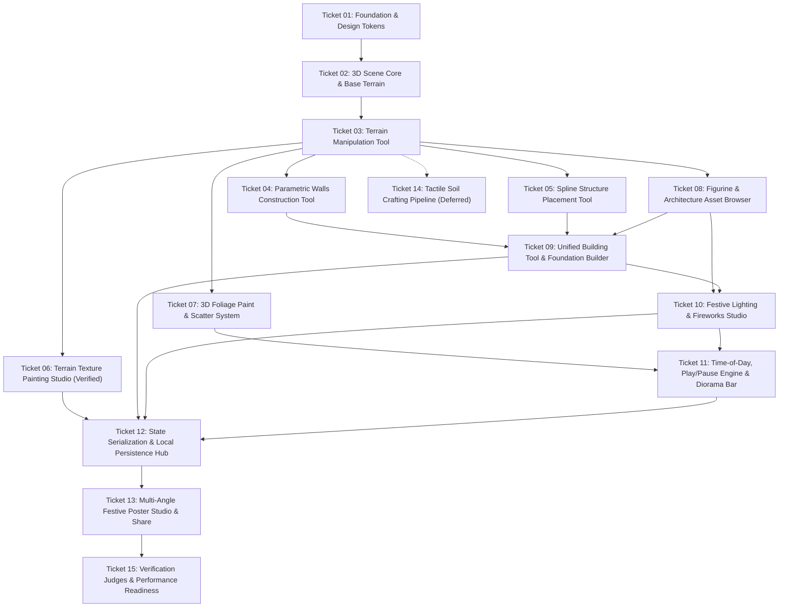

# Killa Playground — Project Roadmap & Tracer Bullet Tickets

This document serves as the master roadmap and tracker for building **Killa Playground**, decomposing the implementation into dependency-ordered tracer-bullet tickets.

The roadmap prioritizes the core Killa construction tools (**Terrain**, **Walls**, **Spline**, **Terrain Paint**, **Foliage Paint**, and **Figurines / Buildings**) so builders can craft and share a complete, historically authentic Diwali Killa immediately, leaving the complex organic soil physics pipeline as a deferred advanced simulation phase.

---

## Dependency Graph

---

## Ticket 01: Project Foundation, Design System Tokens & Responsive Shell

- **Status**: `completed`
- **Blocked by**: None (can start immediately)
- **Delivers**:
  - Initialized Next.js 15 (App Router) + TypeScript + Tailwind CSS application.
  - Complete 3D dependencies (`three`, `@react-three/fiber`, `@react-three/drei`, `three-mesh-bvh`, `three-custom-shader-material`, `fflate`, `zustand`, `zod`, `react-icons/tb`, `lazy-brush`, `canvas-confetti`).
  - Integrated design tokens from `design.md`:
    - Sun-baked canvas (`#F9F6F0`), Dark Brown mineral ink (`#4B382C`).
    - 6-Color Earth Palette: Terracotta (`#B85F45`), Burnt Clay (`#8F4938`), Sand (`#D8C09D`), Camel (`#B58B63`), Olive (`#777A57`), Basalt Charcoal (`#23211E`).
    - Festive Accents: Bhagwa Saffron (`#E85D04`), Chuna White (`#FAF8F5`), Sprouted Halim Green (`#65A30D`), Crinkled Sea Blue (`#0284C7`), Diya Amber (`#F59E0B`).
  - Google Fonts preloaded in `<head>`: `Yatra One`, `Modak`, and `Inter`.
  - Full-bleed responsive diorama canvas shell with non-blocking floating HUD mounts.
  - **Decoupled 5-Zone HUD Layout Architecture**:
    - **Zone 1: Primary App Menu Bar (`AppMenuBar.tsx`)**: Global brand, fort blueprint selector, menus (`File`, `Edit`, `View`, `Language`, `Help`), `EN`|`म`|`हि` language switch, 15-slot undo/redo, night diya mode toggle, and auto-dismissing toast notifications with manual close (`✕`). Pinned top-0 (41px).
    - **Zone 2: Secondary Top Tool Bar (`TopToolBar.tsx`)**: 10 construction/soil tools + camera presets (Z, Y, X, Center, Zoom). Fully minimizable with dynamic hanging tab `[⛰️ Tools & Views ▾]`.
    - **Zone 3: Left Tool Properties Sidebar (`LeftToolSidebar.tsx`)**: Hosts universal/unplaced parameters and initial drafting settings. Resizable from 250px to 480px with tactile 6-dot grip handle. Minimizable with hanging tab `[⚙️ Properties ▾]`.
    - **Zone 4: Vertical Tool Mode Strip (`ToolModeSidebar.tsx`)**: Dedicated 68px vertical strip docked to left sidebar edge. Vertical icon + label buttons for tool-specific operations. Minimizable with hanging tab `[🎯 Modes ▾]`.
    - **Zone 5: Right Scene Outliner & Contextual Inspector (`RightToolSidebar.tsx`)**: Resizable 260px to 460px with tactile grip. Dual-pane: upper `DIORAMA ELEMENTS` tree with expand/collapse, element counts, focus, delete, and hover highlight; lower `ELEMENT PROPERTIES` inspector for selected objects. Minimizable with hanging tab `[🏰 Outliner ▾]`.
  - **Anti-Collision Minimized Guide Tab Positioning**:
    - Coordinated dynamic left and right offsets ensuring all permutations of open and minimized panels never overlap or clip headers.

### Acceptance Criteria
- [x] Application compiles and runs with `npm run dev` at `http://localhost:3000`.
- [x] Canvas viewport expands to 100vw × 100vh with `#F9F6F0` foundation.
- [x] Fonts `Yatra One`, `Modak`, and `Inter` load cleanly with zero FOUT.
- [x] Tailwind tokens configured and verified with test elements.
- [x] Responsive layout adapts cleanly across mobile, tablet, and wide desktop with zero visual overlaps or clipped toolbars.
- [x] Camera controls relocated to secondary toolbar, leaving left sidebar 100% for tool properties.
- [x] Minimized guide tabs line up side-by-side with zero overlap across all open/minimized combinations.

---

## Ticket 02: 3D Scene Core, Camera Rig, Courtyard Bricks & Base Terrain

- **Status**: `completed`
- **Blocked by**: `Ticket 01`
- **Delivers**:
  - Three.js `<Canvas frameloop="demand">` with `<OrbitControls>` (bounded polar angles, smooth damping).
  - Courtyard lighting: warm directional sunlight + ambient bounce + night mode moonlight rig.
  - Base Retaining Brick Border: 3D ring of red clay masonry bricks encircling the mud diorama base.
  - Base Terrain: `THREE.PlaneGeometry(10, 10, 255, 255)` (`65,536` vertices) with `<Bvh>` acceleration (< 0.2ms raycasting).
  - Synchronized `stateBuffer` (`Float32Array` of size `256 x 256 x 4` in `THREE.DataTexture`) storing Elevation (R), Wetness (G), Lock (B), and Grass Density (A).
  - PBR texture loading pipeline connecting Binbun retro textures and mossy stone brick textures.

### Acceptance Criteria
- [x] Diorama canvas displays ground plane with courtyard lighting and brick perimeter border.
- [x] OrbitControls allow smooth 360° orbiting and zooming without clipping beneath the floor.
- [x] Raycaster intersection against terrain mesh executes in `< 0.2ms` via BVH.
- [x] `stateBuffer` initialized and bound to terrain shader pipeline.

---

## Ticket 03: Base Terrain Manipulation Tool

- **Status**: `completed`
- **Blocked by**: `Ticket 02`
- **Delivers**:
  - **Direct Terrain Mesh Sculpting**:
    - **Peak**: Raises mountain mounds, ridges, and hillocks with smooth radial falloff.
    - **Gorge / Trench**: Digs terrain down to carve moat channels, ravines, and valleys.
    - **Plateau / Level**: Flattens sampled vertices to a target plane height $H_{target}$, creating flat courtyards and fort hilltops.
    - **Smooth**: Multi-tap adaptive kernel blur that effectively softens sharp terraces and jagged spikes into rolling earthen curves.
    - **Ramp**: Calibrated inclination subtool with angle presets (15°, 30°, 45°, 60°) for grading smooth paths and fort ascents.
    - **Pond Excavation (Shader-Integrated)**: Excavates crater basins directly in the terrain heightmap and renders authentic blue tarpaulin PBR water with specular ripples directly on the flat basin floor (`wetness > 0.68`), surrounded by dark glistening wet mud (*chikhal*) on crater banks up to the depression rim edge. Eliminates separate meshes, prevents cliff leaks, and restores 100% cleanly on undo.
    - **Retexture**: Restores natural unexcavated soil and basalt surfaces.
  - **Ergonomic Wheel Shortcuts**:
    - `Shift + Scroll Wheel`: Increase / decrease brush size.
    - `Ctrl + Scroll Wheel`: Adjust sculpt speed / strength slider.
    - `Alt + Scroll Wheel`: Adjust plateau height / slope angle.
    - Intercepted in capture phase with complete suppression of camera zoom.

### Acceptance Criteria
- [x] Elevating terrain smoothly raises organic hills and hilltops.
- [x] Lowering terrain excavates depressions that reveal the underlying water plane.
- [x] Plateau tool flattens elevated peaks into level fort construction decks.
- [x] Smoothing tool removes jagged vertices without resetting height.
- [x] Slope tool creates clean graded ramps at 15°, 30°, 45°, 60° presets.
- [x] Excavating ponds renders shader-integrated blue tarpaulin water on basin floors and dark wet mud along banks with full undo/redo support.
- [x] Vertex modifications execute in dirty bounding box ranges without full geometry reallocations.

---

## Ticket 04: Parametric Fort Walls Construction Tool

- **Status**: `completed`
- **Blocked by**: `Ticket 03`
- **Delivers**:
  - **Decoupled 3-Mode Interaction**:
    - **Select Mode**: Inspects walls, corner bastions, watchtowers, rampart platforms, and gates in the Right Scene Outliner and Contextual Inspector. Displays 3D hover highlights (`#E85D04`) and changes cursor to pointer. Selection retention preserves IDs when switching between inspect and edit modes.
    - **Draw Mode**: Click on terrain to draft rampart curves. Start closing node rendered in green, intermediate points in yellow. Features direct "Finish Wall" or "Cancel Draft" actions.
    - **Fortify Mode**: Allows continuous placement of the 3 authentic fortification types via magnetic snap holograms:
      - **Watchtowers**: Sliding continuous round towers snapping to any point along wall segments.
      - **Rampart Bastions**: Inward rectangular stone platforms attached flush to the wall, featuring 3D perimeter protective railings while keeping the outer wall crenellations uninterrupted.
      - **Arched Gateways (*Maha Darwaza*)**: Arched entrances with flanking towers and continuous upper rampart walkways.
  - **Multi-Material PBR Texturing**:
    - Procedural `BufferGeometry` segmented into 3 distinct material groups (`geo.addGroup(start, count, materialIndex)`):
      - **Group 0 (Wall & Tower Sides)**: `mossy_stone_brick_128x128_pbr` (basecolor, normal, roughness, AO).
      - **Group 1 (Walkways & Tower Floors)**: `dark_stone_floor_128x128_pbr` dressed basalt floor slabs for rampart walkways, circular tower/bastion floor decks, and gate lintels.
      - **Group 2 (Battlements & Stone Trims)**: `dark_stone_texture_128x128_pbr` solid dark stone for crenellations (*kangare*), gate soffits, lintel trims, and plinths.
    - Stable material lifecycle in `useMemo([], [])` with `THREE.NearestFilter` and repeat wrapping for authentic retro pixel aesthetic.
  - **Flat 3D Selection Surfaces**:
    - Clickable top floor discs on towers and bastions, portal arch volume meshes on gates, and `BoxPlatformSelectionMesh` on rampart bastions, eliminating floating pin spheres.
  - **Pointer & OrbitControls Isolation**:
    - Strict `e.button === 0` guards on all 3D click handlers ensure right-click and middle-click drag are exclusively reserved for camera navigation without selecting or stamping components.
  - **Miniature Diorama Metric Calibration**:
    - Calibrated default wall height around 25cm (`0.25m`) and thickness to 15cm (`0.15m`) with 12mm ground foundation embedding. Readouts dynamically formatted in centimeters (`cm`).
  - **Authentic Murud-Janjira Pointed Crenellations**:
    - Shaped pointed stone battlements directly matching coastal and Deccan Maratha rampart profiles.
    - Outer-facing orientation automatically detected using 2D polygon centroid testing for closed fort circuits and downhill terrain slope gradient sampling for open wall runs, with manual flip override.
  - **Watertight Maha Darwaza Arched Gateway**:
    - Procedurally carved arched entrance with solid jambs, extruded arch soffit, and continuous top walkway flush with the fort rampart path. Flanked by twin stone bastions.
  - **Real-Time Magnetic Snap Holograms**:
    - Real-time raycast snapping with inward and outward normal calculations (Gate ghost aligned with outward normal, Rampart Bastion ghost aligned with inward courtyard normal).
  - **Defensive Settings Resolution**:
    - Safe fallbacks (`wall.settings || DEFAULT_WALL_SETTINGS`) preventing runtime exceptions on uninitialized objects.

### Acceptance Criteria
- [x] User can click to draft walls that follow terrain contours with "Finish Wall" CTA.
- [x] Wall height and thickness update interactively via sliders in physical centimeters (10cm - 100cm, default 25cm).
- [x] Watchtowers snap continuously along wall segments via magnetic holograms with continuous placement enabled.
- [x] Rampart Bastions attach to walls with protective 3D perimeter railings while preserving outer wall crenellations.
- [x] Fort gates (*Maha Darwaza*) insert cleanly along wall segments with continuous top walkway.
- [x] Multi-material PBR texturing applies stone brick, dark stone floor, and solid basalt stone across geometry groups.
- [x] Right-click drag orbits camera without selecting or stamping components.
- [x] Selection persists cleanly when switching from Select to Fortify mode with pre-activated stamp.

---

## Ticket 05: Spline Structure Placement Tool

- **Status**: `completed`
- **Blocked by**: `Ticket 03`
- **Delivers**:
  - **Decoupled 3-Mode Interaction**:
    - **Select Mode**: Direct physical mesh raycasting on stone steps, saffron flags, and diyas without terrain proximity hijacking. Displays glowing hover outlines (`#E85D04`).
    - **Draw Mode**: Drafts path curves across terrain slopes and atop fort structures using centripetal `THREE.CatmullRomCurve3` (and `LineCurve3` for 2-point segments). Raycast occlusion guard on terrain prevents accidental duplicate points underneath.
    - **Transform Mode**: Translates selected paths in camera-relative directions (Forward, Backward, Left, Right, Up, Down), rotates curves, or adjusts individual item scale without losing active selection.
  - **3 Core Linear Structure Conversions**:
    - **Stone Steps**: Generates stepped horizontal stone boxes ascending slopes. Features 7x larger authentic stone masonry texture scale (`uvMultiplier: 5.0`), lateral offset slider (`stepOffset`: -15cm to +15cm), and stair spacing slider (`stepSpacing`: 1cm to 10cm).
    - **Bhagwa Saffron Flags**: Plants fluttering swallowtail saffron flags at uniform intervals along paths, ridges, or wall ramparts (normalized base scale 1.0x).
    - **Festive Diyas**: Places glowing terracotta oil lamps along path curves for evening illumination (normalized base scale 1.0x).
  - **Clean English UI Voice**:
    - Removed parenthetical Marathi words from UI labels; all language switching handled cleanly through `useTranslation()` (`translations.ts`).

### Acceptance Criteria
- [x] Spline curve drawing cleanly samples 3D surface points across terrain slopes and fort walls.
- [x] Occlusion trapping prevents spline points from leaking through walls to the ground underneath.
- [x] Converting to Stone Steps produces walkable stepped terracing conforming to slope gradient with offset and spacing sliders.
- [x] Converting to Flags places spaced saffron flags with waving swallowtail geometry and pole mast.
- [x] Converting to Diyas arranges warm glowing terracotta oil lamps with flame teardrops along drawn curves.
- [x] Direct physical mesh picking isolates nearby splines without ground proximity hijacking.
- [x] Camera-relative transform controls smoothly translate, rotate, and scale placed spline features.

---

## Ticket 06: Terrain Texture Painting Studio

- **Status**: `completed` (Verified in Browser & Unit Tests)
- **Blocked by**: `Ticket 03`
- **Delivers**:
  - **Direct Terrain Texture Painting**:
    - Paints retro pixel-art textures directly onto the diorama terrain surface without deforming vertex heights or affecting placed walls, splines, or figurines.
  - **Complete 52-Texture Library Across 8 Categories**:
    - **Dirt & Soil (8)**: Compacted Mud, Hydrated Wet Mud, Red Laterite, Clay Silt, Loam Soil, Dry Dirt, Fine Earth, Crumbled Mud.
    - **Grass & Foliage (8)**: Sprouted Mustard Grass, Lush Lawn, Dry Meadow, Olive Turf, Mossy Ground, High Grass, Sprouting Seeds, Dense Field.
    - **Gravel & Paths (8)**: Trail Gravel, Fine Grit, Course Pebbles, Mountain Path, Crushed Stone, River Shingle, Worn Trail, Cobbled Dirt.
    - **Rock & Basalt (8)**: Deccan Basalt, Rugged Slate, Quarry Stone, Weathered Basalt, Sharp Crag, Volcanic Slab, Dark Ledge, Rough Boulder.
    - **Rocky Ground (8)**: Scree Field, Rocky Dirt, Mountain Slag, Pebble Soil, Shaly Terrain, Stony Mud, Chipped Rock, Grit Soil.
    - **Sand (8)**: Sun-Baked Sand, Courtyard Silt, River Dune, Fine Sand, Coarse Dune, Muddy Sand, Beach Soil, Dry Silt.
    - **Bricks & Masonry (3)**: Mossy Stone Brick, Dark Stone Floor, Dark Carved Stone.
    - **Water & Ice (1)**: Blue Tarpaulin Water Sheet.
  - **Technical Architecture & Data Pipeline (`terrainPaintBuffer.ts` & `TerrainMaterial.ts`)**:
    - High-density 256×256×4 `Uint8Array` buffer (262,144 bytes) bound to `THREE.DataTexture`.
    - Channels: R: Layer A (0–51), G: Layer B (0–51), B: Blend Factor (0–255), A: Paint Weight (0–255).
    - `THREE.NearestFilter` on minFilter/magFilter + GLSL `texelFetch` on discrete integer grid coordinates: completely eliminates cross-layer interpolation and seam contour rings.
    - Manual bilinear interpolation in GLSL on continuous float channels (`paintWeight` and same-layer `blendFactor`) for soft feathered edges.
    - Canonical layer ordering (`layerA <= layerB`) across paint and blend brush algorithms for stable gradient transitions.
    - All 52 textures loaded into a single `THREE.DataArrayTexture` (128x128x52) in `THREE.SRGBColorSpace`.
  - **UI/UX & Ergonomics**:
    - Tool renamed to **`Texture`** (key `4`), reserving `paint` for the future soil structure color pipeline.
    - Sliders (Brush Radius, Strength, Edge Falloff, Tiling Repeat) sit directly on the panel background (`bg-[#F3EBE0]`) without enclosing card boxes.
    - Mode selector lives exclusively in the floating `ToolModeSidebar.tsx` strip.
    - Mode-scoped controls: `Paint` (radius, strength, falloff, tiling, flood, clear), `Erase` (radius, strength, clear).
    - Shortcuts: `Shift + Wheel` (Radius), `Ctrl + Wheel` (Strength), `Alt + Wheel` (Falloff), `[` / `]` (Radius step).
    - Dedicated right-side Texture Asset Browser with category pills, dividers, search, and layer index indicators.

### Acceptance Criteria
- [x] User can select any of the 52 textures across 8 categories and paint directly onto terrain.
- [x] Painting produces zero height deformation and does not bleed onto walls, splines, or props.
- [x] Seam border lines (brown, white, gray contour bands) completely eliminated via discrete layer sampling.
- [x] Erase tool smoothly restores unpainted natural base terrain.
- [x] UI respects design guidelines: plain text sliders, mode-specific controls, "Strength" naming, and no parenthetical transliterations.
- [x] 100% client-side compute (₹0 cost) with zero WebGL texture allocation leaks.

---

## Ticket 07: 3D Foliage Paint & Nature Scatter System

- **Status**: `completed`
- **Blocked by**: `Ticket 03`
- **Delivers**:
  - **Retro Doom/PS1 Cross-Quad & Single-Plane Billboard Engine**:
    - High-performance hybrid geometry: 2 intersecting vertical planes (8 vertices, 4 triangles, 12 indices) for volumetric trees/bushes, and single-plane quads for sprawling ground cover, all anchored at ground base $y = 0$.
    - Soft spherical outward normals for uniform, 3D-volumetric lighting on 2D cutout quads.
    - Double-sided rendering with `alphaTest: 0.5` and `depthWrite: true` for zero Three.js sorting artifacts and crisp pixel-art silhouettes.
    - Custom depth material with `alphaTest: 0.5` casting accurate shadow maps onto terrain and walls.
    - Real-time GPU vertex wind sway via material `onBeforeCompile` vertex shader injection with high-frequency fluttering for saplings and low-frequency sway for large canopy trees.
  - **117 Authentic Pixel-Art Foliage Species (7 Categories)**:
    - 117 curated and sanitized 128x128 pixel-art cutout PNG sprites indexed across 7 authentic categories (grass sprites removed from 3D billboard placement to prevent polygon waste; ground turf is authentically handled with zero polygon overhead via Tool 4 Texture Painting):
      - **Canopy Broadleaf (50)**: Banyan, peepal, mango, neem, tamarind, teak, and deodar trees.
      - **Shrubs & Bushes (11)**: Bougainvillea, berry scrub, courtyard hedges, flowering lantana.
      - **Flowering Plants (10)**: Marigold (*gendaphool*), hibiscus, jasmine, periwinkle.
      - **Dry Cliff & Succulents (16)**: Mountain agave, prickly pear, rock crevices, dry thorny brush.
      - **Acacia Savannah (15)**: Spiny acacia, umbrella thorn trees.
      - **Columnar Cypress & Conifers (11)**: Slender Italian cypress, fort sentry conifers.
      - **Coastal Palms (4)**: Coconut palms (curved, slender, tall), date palms, palmyra fan palms.
  - **High-Performance Batched Instancing, Multi-Select Scatter & Spatial Eraser**:
    - Batched rendering via `THREE.InstancedMesh` (exactly 1 draw call per active species) scaling smoothly to 5,000+ instances at 60+ FPS.
    - Uniform disk polar candidate generation with Poisson-disk minimum distance thinning preventing clutter.
    - Bilinear terrain height sampling and surface normal orientation (`getTerrainHeightAt`, `getTerrainNormalAt`), plus direct raycast scattering on fort walls and spline ramparts.
    - **Single Select & Multi-Select Scatter Modes**: Toggle between scattering a single chosen species or randomly picking from multiple selected species with a "Deselect All" convenience button.
    - $O(1)$ spatial hash grid (`FoliageSpatialGrid`) for sub-millisecond radius queries during brush erasing and candidate thinning.
  - **Tri-Mode Workflow & UI/UX Consistency**:
    - **Scatter Mode**: Continuous brush drag painting nature flora across mountain terrain and structures.
    - **Single Mode**: Click-to-place hero specimens with single-point placement reticle.
    - **Erase Mode**: Prune/erase foliage in a radius without affecting underlying terrain or walls.
    - Sliders sit directly on panel background (`bg-[#F3EBE0]`) without enclosing cards: Brush Radius, Density, Scale Jitter, Normal Align.
    - Mode selector lives exclusively in `ToolModeSidebar.tsx`.
    - Dedicated right-side Foliage Asset Browser with search, category pills, counts, and 128x128 pixel-art preview cards.
    - **Permanent Left-Click Action & Right-Click Orbit Control Scheme**: Left click dedicated permanently to active tool operations (`mouseButtons.LEFT = -1`), camera orbit on right-drag, pan on middle-drag, with dynamic bottom contextual info strip and updated keyboard shortcuts modal across EN/MR/HI.
    - Full undo/redo integration with `terrainStore` snapshot history and JSON serialization.

### Acceptance Criteria
- [x] Foliage scatter brush places trees, rocks, and shrubs across terrain, walls, and ramparts.
- [x] Scatter radius and density sliders control brush distribution with single and multi-select support.
- [x] Objects automatically orient to terrain/surface normal or upright Y-axis.
- [x] Rendering 1,000+ scattered instances maintains 60 FPS in single batched draw calls.

---

## Ticket 08: Figurine & Architecture Asset Browser

- **Status**: `completed` (Verified in Browser & Unit Tests)
- **Blocked by**: `Ticket 03`
- **Delivers**:
  - **40 Solid 3D Models Across 7 Authentic Categories**:
    - Sliding right-side drawer with visual preview cards, category filters, counts, and search:
      1. *Royalty & Sinhasan (4)*: Chhatrapati Shivaji Maharaj on the royal throne (*Sinhasan*), cavalry commander, royal attendant, and war elephant.
      2. *Mavale Garrison (4)*: Maratha swordsman, fort sentry spearman, bhagwa flag bearer, and cliff defender.
      3. *Festive Musicians (2)*: Tutari fanfare horn blower, Dhol-Tasha drummer.
      4. *Terracotta Clay Diyas (9)*: 9 unique standalone clay lamp designs (`diya_clay_01` to `diya_clay_09`).
      5. *Hand-Painted Diyas (9)*: 9 vibrant painted color schemes (`diya_color_01` to `diya_color_09`).
      6. *Yard & Props (2)*: Deccan bullock cart and fluttering saffron fort banner.
      7. *Fort Architecture (7)*: Arms depot, elephant stables, fort granary, cavalry stables (with calibrated scale matching fort buildings), fort dungeon/jail, royal kitchen, and soldier quarters.
      8. *Artillery & Ordnance (3)*: Bastion cannon, cannonball crate, and gunpowder magazine.
  - **High-Performance Instanced Batching & Scale Calibration**:
    - Batched rendering via `THREE.InstancedMesh` grouped by figurine type (1 draw call per distinct active type) effortlessly handling 250+ solid 3D figurines at 60+ FPS.
    - Singleton geometry and material cache (`figurineAssetManager`) with automatic base grounding (`y = 0`) and normalized baseline bounding-box scales for humans (0.9m), buildings (3.0m - 4.2m), and artillery (1.2m).
  - **4-Mode Workflow & Right Panel Dual Architecture**:
    - **Place Mode**: Displays Placed Figurines summary and lower Figurine Vault asset browser with live ghost reticle snapping to terrain/wall surfaces, placement scale slider, rotation heading slider, randomize yaw toggle, surface normal alignment, and elevation offset.
    - **Select Mode**: Displays Placed Figurines outliner alongside dedicated Element Properties inspector (scale slider, heading rotation slider, duplicate, snap surface, focus camera, delete) styled consistently with Walls and Spline tools.
    - **Transform Mode**: Displays Placed Figurines outliner and Element Properties inspector with camera-relative 3D nudge pad (Up/Forward/Down/Left/Backward/Right), heading rotation wheel and quick angles, uniform scale slider, and surface snapping.
    - **Erase Mode**: Brush-based radius erasing with `Brush Radius` slider in Left Sidebar, crimson diorama brush ring GUI on terrain/structures, stroke drag erasing, and outliner single/batch deletion.
  - **Ergonomics & Hover Refinements**:
    - Two-way hover highlighting active during Select and Transform modes: hovering a figurine in diorama renders an amber glow ring (`HoverRing`) and highlights the outliner row; hovering an outliner row highlights the 3D figurine in viewport.
    - Hover highlights and pointer cursor changes disabled during Place and Erase modes to eliminate visual clutter and tool confusion.
  - **Processed Transparent Thumbnails & Clean English UI**:
    - Transparent-background WebP/PNG thumbnails for all 40 models (3x3 diya grid cleanly separated into individual icons; corner text and white backgrounds removed).
    - Clean English UI labels with zero redundant parenthetical Marathi transliterations.
  - **Undo / Redo & Secondary Toolbar Header Fixes**:
    - Fixed undo/redo state restoration for both Figurines and Spline tools in `terrainStore.ts`.
    - Fixed `collapseAllPanels` in `useEditorStore.ts` so the secondary toolbar hanging guide tab (`[⛰️ Tools & Views ▾]`) remains visible and clickable alongside `[⚙️ Properties ▾]`, `[🎯 Modes ▾]`, and `[🏰 Outliner ▾]`.

### Acceptance Criteria
- [x] Asset drawer opens smoothly with tabs for Royalty, Mavale, Musicians, Diyas, Props, Architecture, and Artillery.
- [x] All 40 solid 3D models load cleanly with correct relative scale and ground alignment.
- [x] Pre-built buildings, artillery, and figurines can be placed directly onto terrain or fort decks.
- [x] Figurines and props can be dragged, dropped, rotated, transformed, and erased cleanly.
- [x] Placed items persist their transform coordinates in the editor store with working undo/redo.
- [x] "Minimize All" cleanly retains all four hanging guide tabs for quick restoration.

---

## Ticket 09: Unified Building Construction Tool & Foundation Builder

- **Status**: completed
- **Blocked by**: `Ticket 04`, `Ticket 05`, `Ticket 08`
- **Delivers**:
  - **Tool Consolidation & Spline Retirement**:
    - Renames Walls tool to **`Building`** (Key `2`) in the primary toolbar.
    - Completely removes the standalone Spline tool (`spline`, Key `3`). Deprecates redundant flag and diya splines (which now exist as high-fidelity solid 3D models in the Figurine and Lighting tool catalogs).
    - Preserves and integrates stepped stone stairs into the Building tool as **`Stairs` Mode**.
  - **5 Unified Operational Modes in `ToolModeSidebar.tsx`**:
    1. **`Select`**: Direct physical raycast picking of fort walls, bastions, towers, gates, foundations, and stone stairs. Displays glowing amber hover outline (`#E85D04`) and contextually populates the Right Scene Outliner and Element Properties Inspector. Foundation slabs are strictly interactive in Select mode.
    2. **`Walls`**: Click on terrain to draft perimeter wall curves with automatic pointed Murud-Janjira crenellations, continuous elevation tracing, Close Loop (`TbRefresh`), and Finish/Cancel drafting CTAs.
    3. **`Foundation`**: 2-phase drag-and-extrude rectangular stone foundation slabs directly on the terrain:
       - Phase 1 (Base footprint): Pointer down anchors $(x_1, z_1)$; dragging renders live translucent rectangular ghost box to $(x_2, z_2)$.
       - Phase 2 (Height extrusion): Pointer up locks base footprint and switches to vertical height extrusion. Mouse movement dynamically adjusts slab thickness with normalized sensitivity (`0.008`). Left-click confirms and builds the solid slab.
       - Negative Depth: Supports negative heights down to `-10.0m` (extending below terrain surface) up to `+25.0m`.
       - Cancel CTA: Inline Cancel Draft button (`TbX`) in the Left Properties Panel to cleanly abort in-progress drafts.
       - Multi-material buffer geometry partitioning: Perimeter sides mapped to `mossy_stone_brick_128x128_pbr` (Group 0) and top horizontal deck mapped to `dark_stone_floor_128x128_pbr` (Group 1).
    4. **`Stairs`**: Continuous drag-drawing or multi-point slope click path utilizing centripetal `THREE.CatmullRomCurve3` that extrudes stepped horizontal stone masonry boxes conforming to slope gradients, with lateral offset slider (`stepOffset`: -15cm to +15cm), 2x default scale multiplier, and stair spacing slider.
    5. **`Fortifications`**: Continuous magnetic snap hologram placement along walls for 4 authentic fortification types:
       - Watchtowers (`tower` / `buruj`): Sliding cylindrical towers along ramparts.
       - Rampart Platform Bastions (`box`): Inward-facing rectangular fighting platforms.
       - Semicircular Round Bastions (`round_bastion`): Outward-protruding semicircular bastions centered flush on outer wall edge, crowned with 3D pointed Murud-Janjira Kangare battlements with shoulders.
       - Arched Gateways (`gate` / `Maha Darwaza`): Watertight portals with continuous top rampart walkways.
  - **Performance Optimization & Zero GPU/CPU Lag**:
    - Decoupled `wallSnapPreview`, `activeFoundationDraft`, and `hoveredElement` subscriptions from root `FortWalls.tsx` container into dedicated isolated child layers.
    - Memoized `EdgesGeometry` across `SingleWallMesh`, `FoundationMesh`, and `SplineMesh` with cleanup on unmount.
    - Wrapped meshes in `React.memo` with fine-grained state selectors.
    - Explicit `THREE.SRGBColorSpace` and `THREE.LinearMipmapLinearFilter` on diffuse textures, eliminating washed-out bleached white stone appearances.
  - **Unified Outliner & Inspector**:
    - Right Tool Sidebar displays consolidated structures tree under `FORT ARCHITECTURE`: Walls (with nested bastions/towers/gates), Foundations, and Stairs.
    - Element Properties Inspector allows real-time dimension, offset, elevation, and tiling adjustments for selected foundations and stairs.

### Acceptance Criteria
- [x] Top toolbar features "Building" tool; standalone Spline tool is completely removed.
- [x] ToolModeSidebar renders the 5 operational modes: Select, Walls, Foundation, Stairs, Fortifications.
- [x] In Foundation mode, 2-phase drag-to-base and normalized height extrusion functions with negative elevation support and cancel draft CTA.
- [x] Releasing mouse and clicking builds a solid foundation slab textured with stone bricks on sides and dark stone floor on top.
- [x] Foundation height, vertical offset, length, width, and tiling repeat adjust interactively via sliders.
- [x] In Stairs mode, continuous dragging or clicking creates walkable stone staircases with 2x default scale and adjustable spacing.
- [x] Round bastions center flush on outer wall edge with pointed Kangare crenellations matching watchtowers.
- [x] Moving mouse over terrain or structures causes zero frame rate stalls (memoized edges geometry, isolated snap/draft subscriptions).
- [x] Stone brick and basalt textures display authentic dark earthen tones without bleached/white artifacts.
- [x] All building components can be selected, inspected, renamed, and deleted in the Right Outliner.

---

## Ticket 10: Festive Lighting & Fireworks Studio

- **Status**: `completed` (Verified in Browser & Unit Tests)
- **Blocked by**: `Ticket 08`, `Ticket 09`
- **Delivers**:
  - **Dedicated Lighting Tool**:
    - New dedicated **`Lighting`** tool positioned as the **6th and final primary construction tool** (Keys 1-6: Terrain, Building, Texture, Foliage, Figurine, Lighting).
    - Migrates all 18 Diyas (9 terracotta clay + 9 hand-painted) out of the Figurine tool and into the Lighting Studio. Figurine tool is refined strictly to 22 historical royalty, garrisons, architecture, and ordnance models.
  - **Authentic Diwali Pyrotechnics (10 Fireworks Models)**:
    - **5 Cone Fountains (*Anaar*)**: 3D inverted cone models (`ConeGeometry`) with decorative retro Diwali paper wrap canvas textures in 5 vibrant color themes: Saffron Amber, Emerald Green, Royal Violet, Ruby Crimson, and Golden Sparkle.
    - **5 Sky Shots (*Aerial Shells*)**: 3D cylinder launcher models (`CylinderGeometry`) with retro casing textures in 5 festive themes: Multicolored Peony, Golden Willow, Silver Palm, Crackling Comet, and Saffron Ring.
  - **Interactive 3D WebGL Pyrotechnics Engine**:
    - High-performance native Three.js particle engine (`THREE.Points`) using pre-allocated `Float32Array` buffers with zero per-frame garbage collection.
    - Cone Fountains emit a continuous sparkling upward spray with parabolic gravity falloff, crackling embers, and active flickering tip flares.
    - Sky Shots launch an ascending rocket flare tracer with smoke trail that detonates at burst altitude into a dazzling spherical/willow particle burst in the diorama sky.
    - Fully configurable parameters matching pyrotechnic standards: color hue, particle velocity, spray height/spread, burst radius, gravity, and flicker rate.
  - **Consistent 4-Mode Workflow (Place, Select, Transform, Erase)**:
    - `Place`: Left panel renders active preview card + plain text sliders directly on `bg-[#F3EBE0]` (Scale, Heading, Randomize, Normal Align, Elevation Offset); Right panel renders Lighting Vault Asset Browser with search and 3 tabs: Clay Diyas (9), Painted Diyas (9), Fireworks (10).
    - `Select`: Left panel renders selected item summary card + transform sliders + Surface Snap + "Test Firework" button + Duplicate/Delete; Right panel renders Placed Lights Outliner (upper) + Element Properties Inspector (lower) with Burst Height slider for fireworks.
    - `Transform`: Left panel renders fine-grained camera-relative nudge and heading controls; Right panel renders Outliner + Inspector.
    - `Erase`: Left panel renders Brush Radius slider directly on `bg-[#F3EBE0]` + crimson diorama brush circle GUI + Clear All Lights button; Right panel renders Outliner + Inspector.
  - **3D Diya Illumination Engine (Zero Flat Decals & Zero Recompile Freeze)**:
    - Complete elimination of flat 2D decal ground disks (`DiyaLightPools.tsx`), replacing them with authentic 3D PBR illumination that realistically lights up vertical fort walls, ramparts, bastions, figurines, stone steps, and slopes.
    - **16 Statically Pre-Allocated 3D Omnidirectional PointLights** (`#FFA533`, `decay: 2.0`, `distance: 2.2m–4.8m`) compiled statically in JSX. Guarantees **0ms shader recompilation freezes** when placing, moving, or deleting lights.
    - **Camera-Independent 3D World-Coordinate Spatial Clustering** (`computeSpatialClusters`): K-Means clustering in fixed world coordinates guarantees that orbiting the camera 360° causes **zero light popping, zero jumping, and zero white-hot bleaching**.
    - Procedural 3D teardrop flames with organic evening breeze sway, white-hot inner core, and camera-facing volumetric halo sprites (`<sprite>`) with additive blending for luminous visibility from any camera distance.
  - **Diurnal Diya Availability (`getDiyaLightStatus`)**:
    - Diyas automatically ignite during Golden Hour (~16:30 onwards), reach full radiance throughout Diwali Night, and stay lit until morning Dawn (~06:30), or whenever `nightMode` is explicitly enabled.
  - **"Test Firework" Action & Isolated Trigger Pipeline**:
    - Dedicated test trigger pipeline in store (`testFireworkTrigger` with timestamps and cleanup) ensuring fireworks detonate strictly upon clicking the "Test Firework Burst" action button without accidental re-triggers during slider adjustments.
    - Burst height slider for fireworks with a calibrated low default burst (~100cm from launcher).
  - **Zero-Cost State Persistence & Undo/Redo**:
    - Added `PlacedLight` to `SavedProjectSchema` and editor state with undo/redo snapshot buffering, legacy diya migration, burst height serialization, and full reset handling.

### Acceptance Criteria
- [x] Lighting tool appears in Top ToolBar as Key 6; Figurine tool no longer contains diya items.
- [x] Lighting Vault drawer displays 3 tabs: Clay Diyas (9), Painted Diyas (9), and Fireworks (10).
- [x] Placed diyas illuminate in 16 pre-allocated 3D point lights with volumetric halo flames, casting authentic light on vertical fort walls, ramparts, and figurines without flat 2D decal artifacts.
- [x] Camera orbiting 360° produces zero popping or jumping of diya lights.
- [x] Placing and deleting diyas causes zero WebGL shader recompilation freezes (0ms).
- [x] Cone fountains sit upright on terrain/decks and spray sparkling fountain effects on test.
- [x] Sky shots launch upward rockets that explode at adjustable burst heights with colorful particle bursts.
- [x] "Test Firework" button triggers pyrotechnic effects on demand without triggering on property slider edits.
- [x] Placed lights and fireworks can be selected, moved, duplicated, and deleted with full undo/redo.

---

## Ticket 11: Time-of-Day, Play/Pause Animation Engine & Quick-Action Diorama Bar

- **Status**: `completed` (Verified in Browser & Unit Tests)
- **Blocked by**: `Ticket 07`, `Ticket 10`
- **Delivers**:
  - **Dedicated Diorama & Sun View Tool (`view`)**:
    - Primary toolbar **`View`** tool (`view`, Key `7`) designed for pure diorama presentation, inspection, and celestial lighting control.
    - Zero-modification viewport guard: raycasting and drafting disabled during view inspection.
    - Interactive Left Properties Sidebar with:
      - **Time of Day Slider** (`0:00` to `24:00` hours) with dynamic day/night transitions and quick presets: **Dawn (06:00)**, **Noon (12:00)**, **Golden Hour (17:30)**, and **Diwali Night (21:00)**.
      - **Sun / Moon Direction & Elevation (X-Axis Rotation)** slider (`-10°` to `90°` altitude above courtyard horizon) controlling sun/moon trajectory and dynamic shadow length.
      - **Sun / Moon Azimuth** slider (`0°` to `360°` compass bearing) directing shadow orientation across ramparts and courtyards.
      - **Camera Perspectives Presets**: Isometric (45°), Bird's Eye (90° Top-Down), Rampart Eye (15° Low Hero View), Bastion Hero (30° Citadel Corner), and Home Reset.
      - **Camera Lens FOV Slider** (20° Telephoto to 80° Wide-Angle, 45° Standard default).
      - **Dual Navigation Modes**: Free Orbit Spectator Mode (`orbit`) and Continuous 360° Turntable Exhibition Mode (`spin`).
      - **Celebration Fireworks 5s Salvo**: Dedicated test button that triggers all placed fireworks across the diorama for 5 seconds regardless of time, with a 5-second disable cooldown.
  - **Atmospheric Lighting & 24-hr Diurnal Solar Arc Engine (`atmosphericLighting.ts`)**:
    - **Dynamic Color Temperature Grading**: 7 calibrated diurnal keyframes (Midnight 00:00, Dawn 06:00, Noon 12:00, Golden Hour 17:30, Dusk 18:48, Diwali Night 21:00, 24:00).
    - **Luminous Full Moon Night Calibration**: Silver-white moonlight (`#E0F2FE`, 1.35x), indigo shadow fill (`#475569`, 0.85x), dual-radiance hemisphere light (`#93C5FD` sky / `#1E293B` ground, 0.80x), and exposure `1.28`. Eliminates pitch-black voids, rendering terrain, water, cliffs, and fort walls clearly visible.
    - **Vibrant Golden Hour**: Sun 30 minutes before sunset (elevation `20°`, azimuth `255°`, radiant saffron `#F59E0B` 2.80x, courtyard terracotta upward GI bounce `#EA580C` 0.90x, exposure `1.30`).
    - **Zero-Cost Mud GI Bounce Radiance**: Directional light positioned upward from laterite clay simulating secondary bounce illumination.
    - **Deccan Plateau Horizon Mist / Depth Fog**: Exponential squared (`Exp2`) fog blending distant terrain smoothly into the diorama backdrop.
    - **ACESFilmic Tone Mapping & Exposure Calibration**: Prevents specular blowouts on stone and enriches mud and flame saturation.
  - **Centered Quick-Action Diorama Bar (`DioramaQuickBar.tsx`)**:
    - Tactile, floating 5-button control dock mounted centered directly above `BottomStatusBar.tsx`:
      - `☀️ Day`: Transitions diorama to warm daylight courtyard lighting.
      - `▶ Play`: Starts continuous 60 FPS animation loop for trees, particle effects, and continuous night fireworks.
      - `⏸ Pause`: Freezes all wind sway and particle motion; returns canvas to on-demand rendering.
      - `📷 Screenshot`: Hides all HUD chrome, captures the full-resolution WebGL canvas buffer to PNG, triggers direct browser download (`killa-diorama-<timestamp>.png`), and restores the HUD.
      - `🌙 Night`: Transitions to night mode, igniting all placed diyas and firing a celebratory simultaneous fireworks salvo.
  - **Decoupled Animation Engine & Night Fireworks**:
    - Tree vertex wind sway and foliage fluttering are decoupled from mouse movement; animation progression is strictly governed by the `isPlaying` state.
    - Continuous nighttime fireworks playback during dark hours with staggered launches and natural pauses.
    - Cone fountains (*Anaar*) and sky shots feature automatic ±20 cm (±0.20m) height variation and 10° launch angle variation.
    - "Randomize Burst Height" placement toggle switch in Left Tool Sidebar.
    - Deterministic 16-point spatial clustering for diya lights, preventing white-hot bleaching and light-jumping.
  - **Infinite White Grid Removal & Iconography**:
    - Removed `<Grid infiniteGrid />` from the viewport across all tools, giving the diorama an authentic tabletop feel with its courtyard perimeter bricks.
    - All left panel tool headers and controls updated to Tabler React icons (`react-icons/tb`).

### Acceptance Criteria
- [x] Atmospheric lighting engine interpolates 24-hr solar arc with luminous full moon night and vibrant golden hour keyframes.
- [x] Sun/moon direction, elevation, and azimuth sliders sweep dynamic shadows across fort walls and courtyards.
- [x] Diyas automatically ignite during Golden Hour, Dusk, and Night, and remain lit through Dawn.
- [x] Quick-action diorama bar sits centered above the bottom status bar with Day, Play, Pause, Screenshot, and Night buttons.
- [x] Ambient tree fluttering and wind sway progress smoothly when Play is active without requiring mouse moves.
- [x] Clicking Pause immediately halts animation clock and freezes movement.
- [x] Switching to Night mode ignites all diyas and fires all placed fireworks once in celebration.
- [x] Clicking Screenshot captures an unobstructed, high-resolution PNG image directly to browser Downloads.
- [x] Viewport infinite white grid removed across all tools.
- [x] View tool Left Sidebar enriched with camera presets, lens FOV slider, turntable controls, and 5-second fireworks salvo.
- [x] Tool modes provide Orbit Spectator and 360° Turntable Exhibition modes with full raycast drafting suppression.

---

## Ticket 12: State Serialization, Local Persistence Adapter & Project Hub

- **Status**: `ready-for-agent`
- **Blocked by**: `Ticket 06`, `Ticket 09`, `Ticket 10`, `Ticket 11`
- **Delivers**:
  - **Undo / Redo Buffer**:
    - 15-slot in-memory circular buffer tracking terrain edits, building structures (walls, bastions, foundations, stairs), texture paint, foliage instances, figurines, and placed lights/fireworks.
  - **Binary Serialization (`.killa` format)**:
    - Quantize terrain heightmap and paint weight buffers to `Uint8Array`.
    - Package terrain, building foundations, stairs, walls, fortifications, foliage, figurines, and fireworks with `fflate.zipSync` into a compact `< 35 KB` binary package.
  - **Persistence Adapter & Local Vault**:
    - Local storage / IndexedDB implementation (`killa_saved_projects_v1`) persisting named projects with timestamp (`updatedAt`), template type, and diorama payload.
    - Startup modal hub displaying recent locally saved projects with relative time elapsed and one-click loading.
  - **Project File Import & Export**:
    - Desktop file download of `.killa` diorama packages.
    - Native file picker upload to import and restore `.killa` files directly into the 3D canvas.
  - **Defensive Zod Schema**:
    - Validates inbound project payloads, sanitizing coordinates and rejecting malformed files.

### Acceptance Criteria
- [ ] Undo and redo reliably revert and restore sculpting, foundations, stairs, walls, painting, and firework placements.
- [ ] `serializeKilla()` packages complete killa state into $\le 35\text{ KB}$ in $< 15\text{ms}$.
- [ ] Projects save to local storage and appear in the startup hub with last-saved timestamps.
- [ ] `.killa` files can be exported and re-imported cleanly with identical visual reproduction.
- [ ] Inbound payload schema validates types and rejects corrupted payloads.

---

## Ticket 13: Showcase, Multi-Angle Festive Poster Studio & Share

- **Status**: `ready-for-agent`
- **Blocked by**: `Ticket 12`
- **Delivers**:
  - **Historical Blueprint Presets & Random Terrain**:
    - Raigad, Murud-Janjira, and Sinhagad pre-molded terrains with faint chalk outlines, plus "Roll New Terrain".
  - **Automated 4-Angle Poster Generator**:
    - Client-side `OffscreenCanvas(1080, 1920)` rendering 4 cinematic camera angles in $< 400\text{ms}$:
      1. *Hero Bird's-Eye Overview*.
      2. *Maha Darwaza & Bastion Low-Angle*.
      3. *Balekilla Throne & Buildings Close-Up*.
      4. *Golden-Hour / Diwali Night Diya Angle*.
    - Traditional Marathi calligraphic header (`Yatra One`) and festive greeting (`Modak`): *"दिवाळीच्या हार्दिक शुभेच्छा"*.
    - Builder name and fort title customization.
    - Instant high-res PNG/JPG download + `navigator.share()` / clipboard link integration.
  - **Shared 3D Viewer Route**:
    - Read-only diorama viewer at `/killa/[id]`.

### Acceptance Criteria
- [ ] "Finish Killa" opens the Poster Studio Modal and generates the 4-angle festive collage.
- [ ] Poster includes placed foundations, stairs, buildings, and glowing diyas.
- [ ] User can customize fort title and builder name in Devanagari or English.
- [ ] "Download Poster" produces a crisp, high-resolution PNG file.
- [ ] Shared link route `/killa/[id]` renders the 3D diorama in read-only orbit mode.

---

## Ticket 14: Tactile Soil & Mud Crafting Pipeline (Deferred / Advanced Phase)

- **Status**: `deferred`
- **Blocked by**: `Ticket 03`
- **Delivers**:
  - **Organic Soil Simulation Layer**:
    - **Tool 1: Dump Dry Soil**: Adds Gaussian elevation mound with simplex noise roughness; wetness set to 0.0.
    - **Tool 2: Pour Water**: Smooths height noise with 3x3 box blur, darkens soil, and increases wetness (+0.15), reducing material roughness from 0.95 to 0.2 (`cracked_red_ground_1k`).
    - **Tool 3: Hand Shaper (Push & Pat)**:
      - *Top Patting*: Levels wet mud to sampled plane height $H_{target}$.
      - *Side Pushing*: Compresses wet mud along pointer drag vector into steep vertical wall faces.
    - **Tool 4: Drying & Mud Locking**: Writes 1.0 to lock state, hardening mud into immutable stone.
    - **Tool 5: Freehand Mud Paint**: XL/Medium/Fine brush with `lazy-brush` stabilizer for hand-painting dark basalt base coats and white lime (*chuna*) brick divider lines over dried mud masses.

### Acceptance Criteria
- [ ] Soil dumping raises loose crumbly mounds.
- [ ] Pouring water darkens soil and adds glossy specular sheen.
- [ ] Hand shaper tools mold wet mud into plateaus and vertical wall faces.
- [ ] Drying tool locks mud to prevent unwanted brush deformation.
- [ ] Freehand paint applies mortar lines with steady-hand stabilization.

---

## Ticket 15: Verification Judges, Testing & Deployment Readiness

- **Status**: `ready-for-agent`
- **Blocked by**: `Ticket 13`
- **Delivers**:
  - **Vitest Unit Tests**:
    - Serialization/deserialization byte-size check ($\le 35\text{ KB}$).
    - Zod schema defensive boundaries ($NaN$ rejection, prop limit $\le 250$).
    - Building foundation geometry bounds and stairs path extrusion tests.
    - Lighting manifest integrity and pyrotechnic variation checks.
  - **GPU Resource Disposal Audit**:
    - Verify clean `.dispose()` on all textures, materials, and geometries on unmount.
  - **Performance Benchmarks**:
    - 60 FPS maintained under 1,000 foliage instances, 50 props/fireworks, 20 foundations, and 100 wall segments.
  - **Documentation**:
    - `README.md` with setup and build instructions.
    - Complete asset manifest for textures, models, pyrotechnics, and audio.

### Acceptance Criteria
- [ ] `npm run test` executes all Vitest suites with 100% pass rate.
- [ ] Zero GPU memory leaks on repeated terrain regeneration or scene resets.
- [ ] `npm run build` succeeds without TypeScript or bundling errors.
- [ ] Setup instructions for deployment documented in `README.md`.
