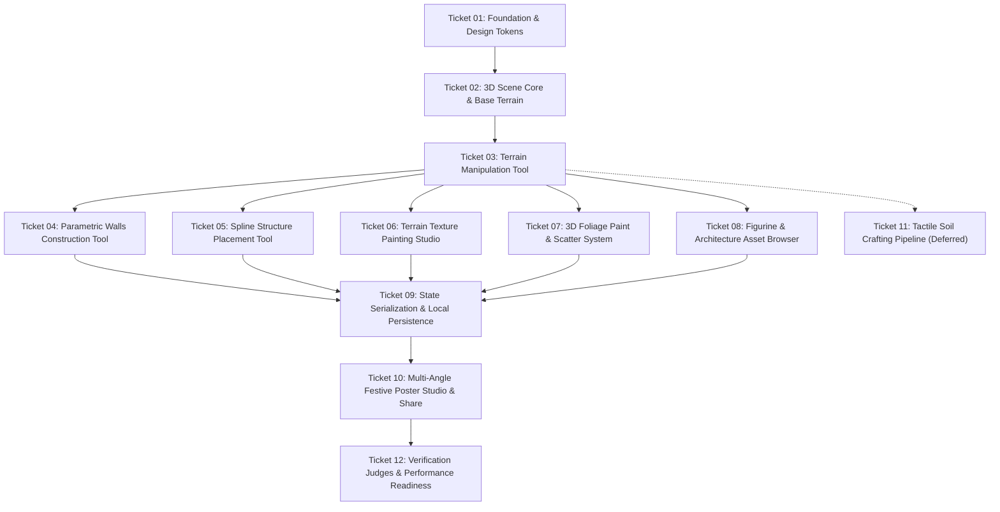

# Killa Playground — Project Roadmap & Tracer Bullet Tickets

This document serves as the master roadmap and tracker for building **Killa Playground**, decomposing the implementation into dependency-ordered tracer-bullet tickets.

The roadmap prioritizes the core Killa construction tools (**Terrain**, **Walls**, **Spline**, **Terrain Paint**, **Foliage Paint**, and **Figurines / Buildings**) so builders can craft and share a complete, historically authentic Diwali Killa immediately, leaving the complex organic soil physics pipeline as a deferred advanced simulation phase.

---

## Dependency Graph

---

## Ticket 01: Project Foundation, Design System Tokens & Responsive Shell

- **Status**: `completed`
- **Blocked by**: None (can start immediately)
- **Delivers**:
  - Initialized Next.js 15 (App Router) + TypeScript + Tailwind CSS application.
  - Complete 3D dependencies (`three`, `@react-three/fiber`, `@react-three/drei`, `three-mesh-bvh`, `three-custom-shader-material`, `fflate`, `zustand`, `zod`, `lucide-react`, `lazy-brush`, `canvas-confetti`).
  - Integrated design tokens from `design.md`:
    - Sun-baked canvas (`#F9F6F0`), Dark Brown mineral ink (`#4B382C`).
    - 6-Color Earth Palette: Terracotta (`#B85F45`), Burnt Clay (`#8F4938`), Sand (`#D8C09D`), Camel (`#B58B63`), Olive (`#777A57`), Basalt Charcoal (`#23211E`).
    - Festive Accents: Bhagwa Saffron (`#E85D04`), Chuna White (`#FAF8F5`), Sprouted Halim Green (`#65A30D`), Crinkled Sea Blue (`#0284C7`), Diya Amber (`#F59E0B`).
  - Google Fonts preloaded in `<head>`: `Yatra One`, `Modak`, and `Inter`.
  - Full-bleed responsive diorama canvas shell with non-blocking floating HUD mounts.

### Acceptance Criteria
- [x] Application compiles and runs with `npm run dev` at `http://localhost:3000`.
- [x] Canvas viewport expands to 100vw × 100vh with `#F9F6F0` foundation.
- [x] Fonts `Yatra One`, `Modak`, and `Inter` load cleanly with zero FOUT.
- [x] Tailwind tokens configured and verified with test elements.

---

## Ticket 02: 3D Scene Core, Camera Rig, Courtyard Bricks & Base Terrain

- **Status**: `ready-for-agent`
- **Blocked by**: `Ticket 01`
- **Delivers**:
  - Three.js `<Canvas frameloop="demand">` with `<OrbitControls>` (bounded polar angles, smooth damping).
  - Courtyard lighting: warm directional sunlight + ambient bounce + night mode moonlight rig.
  - Base Retaining Brick Border: 3D ring of red clay masonry bricks encircling the mud diorama base.
  - Base Terrain: `THREE.PlaneGeometry(10, 10, 255, 255)` (`65,536` vertices) with `<Bvh>` acceleration (< 0.2ms raycasting).
  - Synchronized `stateBuffer` (`Float32Array` of size `256 x 256 x 4` in `THREE.DataTexture`) storing Elevation (R), Wetness (G), Lock (B), and Grass Density (A).
  - PBR texture loading pipeline connecting Binbun retro textures and mossy stone brick textures.

### Acceptance Criteria
- [ ] Diorama canvas displays ground plane with courtyard lighting and brick perimeter border.
- [ ] OrbitControls allow smooth 360° orbiting and zooming without clipping beneath the floor.
- [ ] Raycaster intersection against terrain mesh executes in `< 0.2ms` via BVH.
- [ ] `stateBuffer` initialized and bound to terrain shader pipeline.

---

## Ticket 03: Base Terrain Manipulation Tool

- **Status**: `ready-for-agent`
- **Blocked by**: `Ticket 02`
- **Delivers**:
  - **Direct Terrain Mesh Sculpting**:
    - **Elevate**: Raises mountain mounds, ridges, and hillocks with smooth radial falloff.
    - **Lower**: Digs terrain down to carve moat beds, trenches, and valleys.
    - **Plateau / Level**: Flattens sampled vertices to a target plane height $H_{target}$, creating flat courtyards and fort hilltops.
    - **Smooth**: Applies a 3x3 box blur to soften jagged terrain edges.
    - **Pond Excavation**: Depresses terrain below water plane ($Y < 0.08$) to automatically create water cisterns or blue plastic ponds.
  - **Brush Controls**: Ergonomic brush radius (0.2m to 3.0m) and strength sliders in the contextual dock.
  - **Partial Dirty-Box Updates**: Updates `PlaneGeometry.attributes.position` strictly inside `[minX..maxX, minY..maxY]`, calling `addUpdateRange` and `bvh.refit()`.

### Acceptance Criteria
- [ ] Elevating terrain smoothly raises organic hills and hilltops.
- [ ] Lowering terrain excavates ponds that reveal the underlying water plane.
- [ ] Plateau tool flattens elevated peaks into level fort construction decks.
- [ ] Smoothing tool removes jagged vertices without resetting height.
- [ ] Vertex modifications execute in dirty bounding box ranges without full geometry reallocations.

---

## Ticket 04: Parametric Fort Walls Construction Tool

- **Status**: `ready-for-agent`
- **Blocked by**: `Ticket 03`
- **Delivers**:
  - **Direct Wall Generation**:
    - Enables users to draw wall lines or curves conforming directly to the underlying terrain elevation.
    - Instant fort construction for builders who want ramparts without manual soil sculpting.
  - **Rich Parametric Customization**:
    - **Wall Height**: Adjustable slider (e.g. 0.5m to 4.0m).
    - **Towers / Bastions (*Buruj*)**: Toggle round bastions at path vertices or automatically at corners $> 35^\circ$, with custom tower radius.
    - **Gates (*Maha Darwaza*)**: Insert arched gates into wall segments.
    - **Gatehouse**: Toggle fortified gatehouse structures flanking the main entrance.
    - **Crenellations (*Kangare*)**: Toggle alternating notched stone merlons along the top ridge.
    - **Brick Texture Scale**: Adjustable UV tiling slider for brick/masonry stone textures.
  - **Geometry Pipeline**: Efficient extruded wall geometry with UV mapping for mossy stone brick textures.

### Acceptance Criteria
- [ ] User can click and drag to draw a wall that follows terrain contours.
- [ ] Wall height updates interactively via slider.
- [ ] Round bastions (*buruj*) automatically or manually spawn at corners.
- [ ] Fort gates (*Maha Darwaza*) can be inserted cleanly along wall segments.
- [ ] Crenellations (*kangare*) render alternating battlements along wall tops.
- [ ] Brick texture scale adjusts stone tile density without visual distortion.

---

## Ticket 05: Spline Structure Placement Tool

- **Status**: `ready-for-agent`
- **Blocked by**: `Ticket 03`
- **Delivers**:
  - **Interactive 3D Curve Drawing**:
    - Draws smooth 3D spline paths across terrain surfaces using `THREE.CatmullRomCurve3`.
  - **Linear Structure Conversions**:
    - **Stone Steps (*Payrya*)**: Generates stepped horizontal mud/stone boxes ascending slopes from lower courtyards to high fort plateaus.
    - **Bhagwa Saffron Flags**: Automatically arranges waving swallowtail saffron flags at uniform intervals along the path.
    - **Festive Divas (Diyas)**: Places glowing terracotta oil lamps along drawn curves for festive illumination.
  - *(Note: Walkway paths are handled via the Terrain Paint Tool rather than splines).*

### Acceptance Criteria
- [ ] Spline curve drawing cleanly samples 3D surface points across slopes.
- [ ] Converting to Stone Steps produces walkable stepped terracing conforming to slope gradient.
- [ ] Converting to Flags places spaced saffron flags with wind sway vertex shader.
- [ ] Converting to Divas arranges warm glowing oil lamps along the drawn path.

---

## Ticket 06: Terrain Texture Painting Studio

- **Status**: `ready-for-agent`
- **Blocked by**: `Ticket 03`
- **Delivers**:
  - **Direct Terrain Texture Painting**:
    - Paints surface textures directly onto the terrain mesh without deforming elevation or affecting placed structures/walls.
  - **Authentic Texture Palette**:
    - **Dirt**: Classic red laterite courtyard soil (*Tambdi Maati*).
    - **Sand**: Courtyard silt and beach sand.
    - **Grass**: Lush green ground cover.
    - **Gravel**: Crushed rock and worn pathway trails.
    - **Rock**: Rugged Deccan Basalt cliff escarpments.
    - **Rocky Ground**: Mixed pebble and mountain dirt.
  - **Brush Controls**:
    - Adjustable brush radius, opacity/strength, and smooth falloff.
  - **Splat / Blend Pipeline**:
    - Multi-texture blending implemented via weight maps in custom terrain shader.

### Acceptance Criteria
- [ ] User can select any texture (Dirt, Sand, Grass, Gravel, Rock, Rocky) and paint onto terrain.
- [ ] Painting gravel cleanly creates natural pathways without modifying terrain height.
- [ ] Painting does not bleed onto or distort walls, splines, or placed figurines.
- [ ] Texture blending transitions smoothly at brush borders.

---

## Ticket 07: 3D Foliage Paint & Nature Scatter System

- **Status**: `ready-for-agent`
- **Blocked by**: `Ticket 03`
- **Delivers**:
  - **3D Asset Scatter Brush**:
    - Interactive scatter brush placing low-poly 3D nature props onto the terrain surface.
  - **Asset Selection Library**:
    - **Trees**: Stylized Deccan banyan, neem, and mountain acacia trees.
    - **Rocks**: Scattered basalt boulders and pebbles.
    - **Shrubs**: Hardy mountain scrub and bushes.
    - **Grass Clumps**: 3D sprouted mustard/*halim* seedling models.
  - **Scatter Parameters**:
    - Scatter radius slider.
    - Density slider (instances per stroke).
    - Random scale jitter (0.8x to 1.3x) and random Y-axis rotation.
  - **Performance Optimization**:
    - Batched rendering via `<Instances>` or `THREE.InstancedMesh` (1 draw call per asset type).

### Acceptance Criteria
- [ ] Foliage scatter brush places trees, rocks, shrubs, and 3D grass models across the terrain.
- [ ] Scatter radius and density sliders control brush distribution.
- [ ] Objects automatically orient to terrain normal or upright Y-axis.
- [ ] Rendering 1,000+ scattered instances maintains 60 FPS in single batched draw calls.

---

## Ticket 08: Figurine & Architecture Asset Browser

- **Status**: `ready-for-agent`
- **Blocked by**: `Ticket 03`
- **Delivers**:
  - **Categorized Asset Drawer**:
    - Sliding right-side drawer with visual preview cards:
      1. *Royalty & Sinhasan*: Chhatrapati Shivaji Maharaj on the royal throne (*Sinhasan*), ornate canopy (*Meghdambari*).
      2. *Mavale*: Standing spearmen, swordsmen in traditional festive attire.
      3. *Musicians*: Tutari horn blowers, Dhol-Tasha drummers.
      4. *Buildings & Fort Architecture*: Pre-built watchtowers, bastions, temple shrines, fort houses, stone arches (allowing instant architectural staging for time-constrained users).
      5. *Artillery & Yard Props*: Cannons, cannonballs, bullock carts, wooden barrels, paper boats, terracotta diyas.
  - **Placement & Transform Controls**:
    - Raycast drag-and-drop onto terrain, walls, or plateau tops.
    - Interactive rotation ring/gizmo to face figurines in any direction.
    - Ground snapping ensuring props sit flush on surfaces.

### Acceptance Criteria
- [ ] Asset drawer opens smoothly with tabs for Royalty, Mavale, Musicians, Buildings, and Props.
- [ ] Pre-built buildings can be placed directly onto terrain or fort decks.
- [ ] Figurines and props can be dragged, dropped, rotated, and positioned accurately.
- [ ] Placed items persist their transform coordinates in the editor store.

---

## Ticket 09: State Serialization, Local Persistence Adapter & Project Hub

- **Status**: `ready-for-agent`
- **Blocked by**: `Ticket 04`, `Ticket 05`, `Ticket 06`, `Ticket 07`, `Ticket 08`
- **Delivers**:
  - **Undo / Redo Buffer**:
    - 15-slot in-memory circular buffer tracking terrain edits, walls, splines, paint textures, foliage, and placed figurines.
  - **Binary Serialization (`.killa` format)**:
    - Quantize terrain heightmap and paint weight buffers to `Uint8Array`.
    - Package terrain, walls, splines, foliage instances, and figurine transforms with `fflate.zipSync` into a compact `< 35 KB` binary package.
  - **Persistence Adapter & Local Vault**:
    - Local storage / IndexedDB implementation (`killa_saved_projects_v1`) persisting named projects with timestamp (`updatedAt`), template type, and diorama payload.
    - Startup modal hub displaying recent locally saved projects with relative time elapsed and one-click loading.
  - **Project File Import & Export**:
    - Desktop file download of `.killa` diorama packages.
    - Native file picker upload to import and restore `.killa` files directly into the 3D canvas.
  - **Defensive Zod Schema**:
    - Validates inbound project payloads, sanitizing coordinates and rejecting malformed files.

### Acceptance Criteria
- [ ] Undo and redo reliably revert and restore sculpting, wall changes, painting, and prop placements.
- [ ] `serializeKilla()` packages complete killa state into $\le 35\text{ KB}$ in $< 15\text{ms}$.
- [ ] Projects save to local storage and appear in the startup hub with last-saved timestamps.
- [ ] `.killa` files can be exported and re-imported cleanly with identical visual reproduction.
- [ ] Inbound payload schema validates types and rejects corrupted payloads.

---

## Ticket 10: Showcase, Multi-Angle Festive Poster Studio & Share

- **Status**: `ready-for-agent`
- **Blocked by**: `Ticket 09`
- **Delivers**:
  - **Historical Blueprint Presets & Random Terrain**:
    - Raigad, Murud-Janjira, and Sinhagad pre-molded terrains with faint chalk outlines, plus "Roll New Terrain".
  - **Automated 4-Angle Poster Generator**:
    - Client-side `OffscreenCanvas(1080, 1920)` rendering 4 cinematic camera angles in $< 400\text{ms}$:
      1. *Hero Bird's-Eye Overview*.
      2. *Maha Darwaza & Bastion Low-Angle*.
      3. *Balekilla Throne & Buildings Close-Up*.
      4. *Golden-Hour / Diwali Night Diya Angle*.
    - Traditional Marathi calligraphic header (`Yatra One`) and festive greeting (`Modak`): *"दिवाळीच्या हार्दिक शुभेच्छा"*.
    - Builder name and fort title customization.
    - Instant high-res PNG/JPG download + `navigator.share()` / clipboard link integration.
  - **Shared 3D Viewer Route**:
    - Read-only diorama viewer at `/killa/[id]`.

### Acceptance Criteria
- [ ] "Finish Killa" opens the Poster Studio Modal and generates the 4-angle festive collage.
- [ ] User can customize fort title and builder name in Devanagari or English.
- [ ] "Download Poster" produces a crisp, high-resolution PNG file.
- [ ] Shared link route `/killa/[id]` renders the 3D diorama in read-only orbit mode.

---

## Ticket 11: Tactile Soil & Mud Crafting Pipeline (Deferred / Advanced Phase)

- **Status**: `deferred`
- **Blocked by**: `Ticket 03`
- **Delivers**:
  - **Organic Soil Simulation Layer**:
    - **Tool 1: Dump Dry Soil**: Adds Gaussian elevation mound with simplex noise roughness; wetness set to 0.0.
    - **Tool 2: Pour Water**: Smooths height noise with 3x3 box blur, darkens soil, and increases wetness (+0.15), reducing material roughness from 0.95 to 0.2 (`cracked_red_ground_1k`).
    - **Tool 3: Hand Shaper (Push & Pat)**:
      - *Top Patting*: Levels wet mud to sampled plane height $H_{target}$.
      - *Side Pushing*: Compresses wet mud along pointer drag vector into steep vertical wall faces.
    - **Tool 4: Drying & Mud Locking**: Writes 1.0 to lock state, hardening mud into immutable stone.
    - **Tool 5: Freehand Mud Paint**: XL/Medium/Fine brush with `lazy-brush` stabilizer for hand-painting dark basalt base coats and white lime (*chuna*) brick divider lines over dried mud masses.

### Acceptance Criteria
- [ ] Soil dumping raises loose crumbly mounds.
- [ ] Pouring water darkens soil and adds glossy specular sheen.
- [ ] Hand shaper tools mold wet mud into plateaus and vertical wall faces.
- [ ] Drying tool locks mud to prevent unwanted brush deformation.
- [ ] Freehand paint applies mortar lines with steady-hand stabilization.

---

## Ticket 12: Verification Judges, Testing & Deployment Readiness

- **Status**: `ready-for-agent`
- **Blocked by**: `Ticket 10`
- **Delivers**:
  - **Vitest Unit Tests**:
    - Serialization/deserialization byte-size check ($\le 35\text{ KB}$).
    - Zod schema defensive boundaries ($NaN$ rejection, prop limit $\le 250$).
    - Terrain height clamping and dirty bounding box arithmetic.
  - **GPU Resource Disposal Audit**:
    - Verify clean `.dispose()` on all textures, materials, and geometries on unmount.
  - **Performance Benchmarks**:
    - 60 FPS maintained under 1,000 foliage instances, 50 props, and 100 wall segments.
  - **Documentation**:
    - `README.md` with setup and build instructions.
    - Complete asset manifest for textures, models, and audio.

### Acceptance Criteria
- [ ] `npm run test` executes all Vitest suites with 100% pass rate.
- [ ] Zero GPU memory leaks on repeated terrain regeneration or scene resets.
- [ ] `npm run build` succeeds without TypeScript or bundling errors.
- [ ] Setup instructions for deployment documented in `README.md`.
